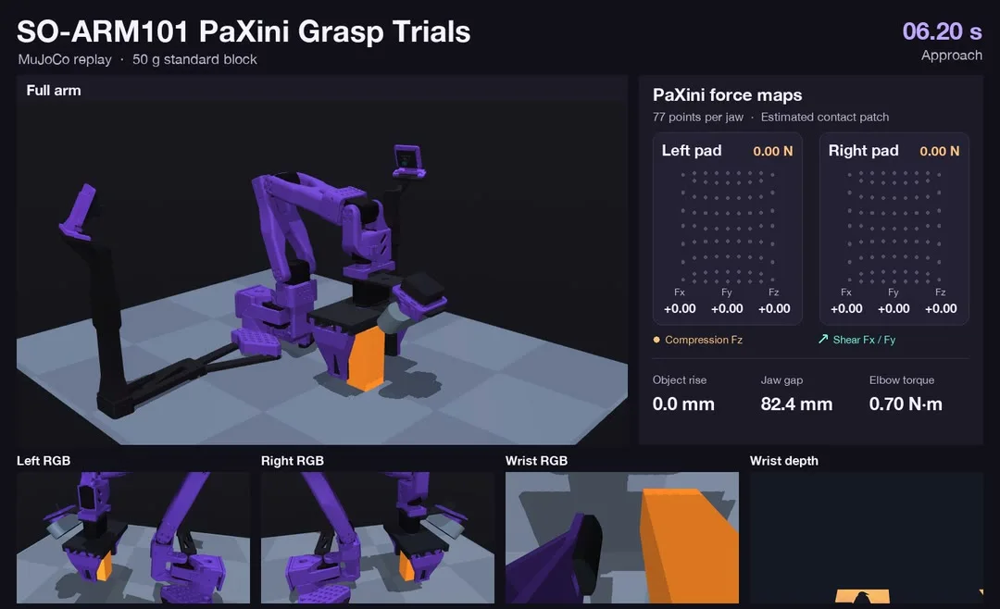
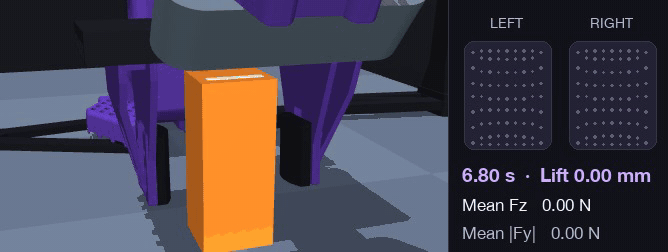
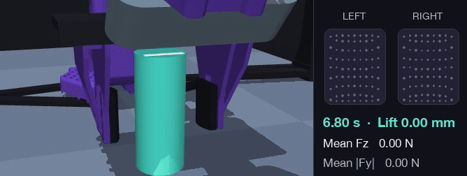
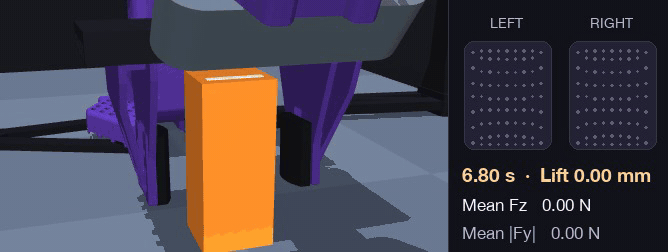
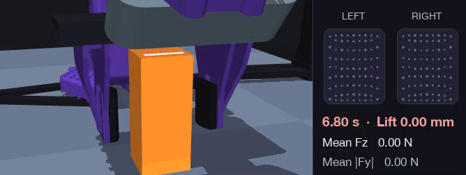
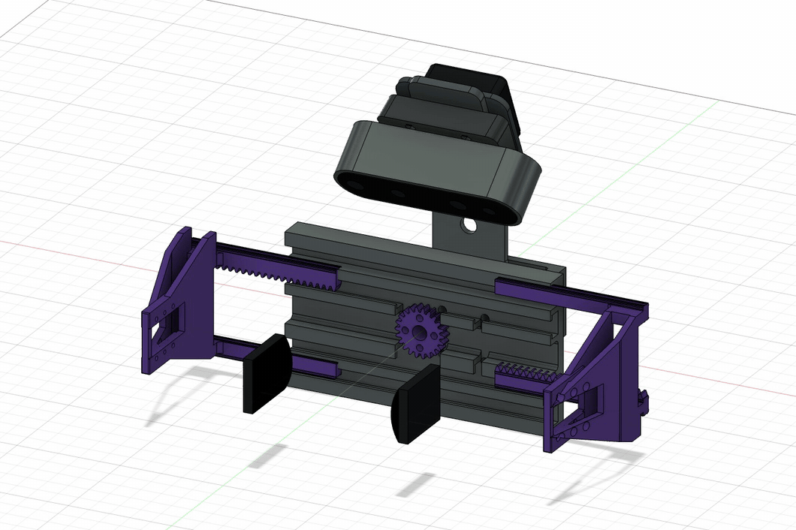
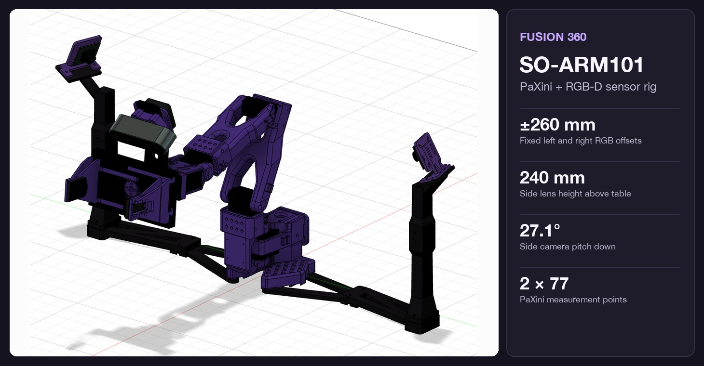
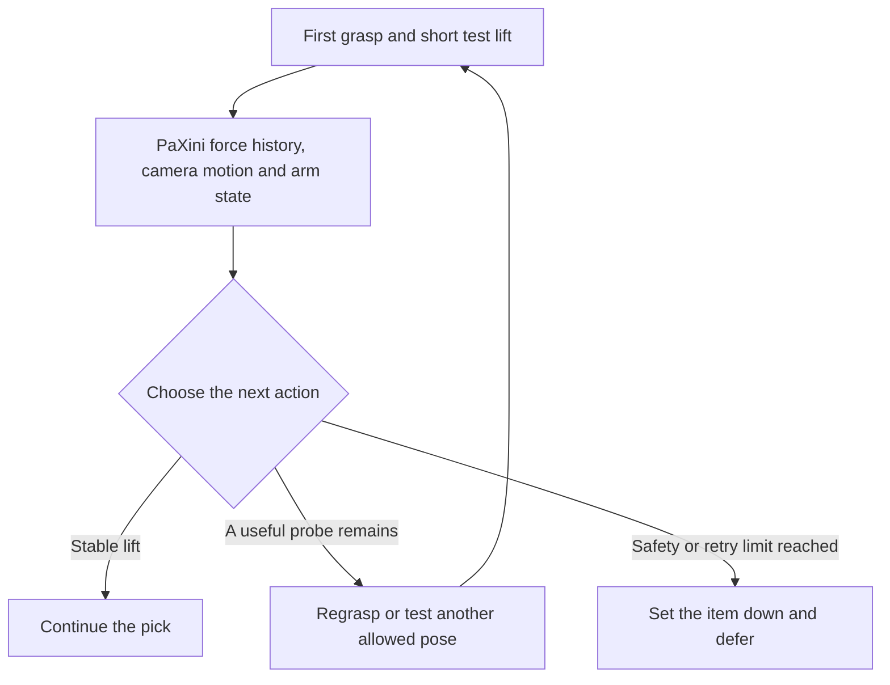

# Regrasp or Skip? Tactile Probing for Agentic Robot Manipulation

**A PaXini-equipped SO-ARM101 testbed for studying when a robot should lift, regrasp, or skip after contact**

[Watch the full-arm replay](https://github.com/jhyeong687/tactile-grasp-agent/releases/download/v0.2.2/so101-dashboard-synchronized-replay.mp4) · **[Download the reproduction kit](https://github.com/jhyeong687/tactile-grasp-agent/releases/download/v0.2.2/so101-tactile-recovery-kit.zip)** · [Pipeline and roadmap](#recovery-pipeline-and-roadmap) · [한국어 연구 기록](docs/research-notes.ko.md)

A weak lift can follow from poor contact, a slippery surface, or a load the arm cannot raise in its current posture. This pilot builds a gripper and sensor rig to compare those cases under the same motion.

**MuJoCo latch pilot · Did It Come That Way?** A light wiggle distinguished the two initial latch states in 10/10 perturbed simulation trials. Pressing the loose lid seated it in 5/5 trials, and the bolt retained it after the gripper withdrew. [Workbench replay, results and data](docs/latch-pilot.ko.md) · [Astra experimental protocol](docs/tactile-inspection-protocol.ko.md)

**Conveyor pilot · Regrasp or Let It Pass?** The same loaded part was picked after indexing closer at 25 mm/s and passed at 55 mm/s. Across eight paired conditions, the force rule delivered 7/8 and Astra `xhigh` delivered 6/8 with the simulator clock paused for inference. [Workbench replays and measurements](docs/conveyor-pilot.ko.md)

**Waypoint stacking pilot.** GPT-6.2 Astra generated lift and placement waypoints for the same 85 g shell with mirrored internal ballast. Adding PaXini force and moment data changed its release targets and stabilized both variants in MuJoCo. [Videos, commands and sensor traces](docs/stacking-waypoint-pilot.ko.md)

**Next study · Tactile Evidence for Agentic Manipulation.** Keep appearance fixed and change the hidden physics. Measure whether tactile feedback changes an agent's waypoints across stacking, latch inspection, and insertion. [Evaluation suite](docs/tactile-agent-suite.ko.md) · [Stacking protocol and stability check](docs/tactile-stacking-protocol.ko.md)

## Four grasps on one time axis

At **5.29 N per jaw**, the standard block lifted **11.60 mm** and the slippery block rose **0.00 mm** in the MuJoCo pilot.

<table>
  <tr>
    <td width="50%" align="center">
      <strong>Standard block</strong> 
       
      50 g · friction 0.80 · rise 11.60 mm at 8.90 s
    </td>
    <td width="50%" align="center">
      <strong>Cylinder</strong> 
       
      50 g · friction 0.80 · rise 11.47 mm at 8.90 s
    </td>
  </tr>
  <tr>
    <td width="50%" align="center">
      <strong>Slippery block</strong> 
       
      50 g · friction 0.018 · rise 0.00 mm at 8.90 s
    </td>
    <td width="50%" align="center">
      <strong>Heavy block</strong> 
       
      600 g · friction 0.80 · rise 0.93 mm at 8.90 s
    </td>
  </tr>
</table>

Each clip uses the same simulation timestamps. The dot colors show compression and arrows show in-plane force on the estimated contact patch. Use the [synchronized MP4](https://github.com/jhyeong687/tactile-grasp-agent/releases/download/v0.2.2/so101-four-grasps.mp4) for frame-locked playback. The lift command runs from 7.50 to 8.90 s.

| Condition | Mass | Pad friction | Object rise | Mean Fz per jaw | Mean abs. Fy per jaw |
| --- | ---: | ---: | ---: | ---: | ---: |
| Standard block | 50 g | 0.80 | **11.60 mm** | 5.29 N | 0.24 N |
| Cylinder | 50 g | 0.80 | **11.47 mm** | 5.15 N | 0.24 N |
| Slippery block | 50 g | 0.018 | **0.00 mm** | 5.29 N | 0.09 N |
| Heavy block | 600 g | 0.80 | **0.93 mm** | 5.39 N | 2.70 N |

The heavy block applies more tangential force at the same nominal friction as the standard block. Each row comes from one scripted simulation episode. The next experiments test how well these cues predict recovery across different grasps and objects.

[8.90 s comparison image](media/grasp-comparison.jpg) · [1,644 time samples in CSV](data/trial-traces.csv) · [40 tactile snapshots in JSON](data/tactile-pilot.json) · [Data schema](data/README.md)

## How the rig comes together

[Fusion assembly MP4](https://github.com/jhyeong687/tactile-grasp-agent/releases/download/v0.2.2/so101-fusion-assembly.mp4)

### R4 gripper design film

[R4 design film MP4](https://github.com/jhyeong687/tactile-grasp-agent/releases/download/v0.2.2/so101-gripper-r4.mp4)

### Build details

| Design iteration | Work completed | Verification |
| --- | --- | --- |
| **R4 tactile jaws** | Fit two M3025 pads to a rod-free rack-and-pinion gripper. Join the two forward screw supports to form a rectangular cable window. | In CAD, the bridge tip is 0.8 mm behind the sensor face. The checked sensor-face gap is 10.4–82.4 mm. |
| **R5 wrist and cable routing** | Keep the D435i on the wrist, lighten its bridge and compare wrist-side and forearm PaXini box routes. | Bridge volume 14.73 → 8.62 cm³. CAD mass estimates for the two tool configurations were about 307 g and 281 g. Actual masses and motor limits require a bench check. |
| **R7 fixed RGB mounts** | Add black rails and split masts with violet mounts for the left and right SA26MCM cameras. | Each lens is 260 mm off center, 240 mm above the table and pitched down 27.1°. The longest new print is 143 mm. No robot–mount intersections appeared in 51 sampled CAD poses. |

[26 cm STLs](cad/rgb-26cm/STL) · [Color STEP assembly](cad/rgb-26cm/mount-assembly.step) · [Wrist and fit-check parts](cad/wrist-and-fit) · [Assembly order and fasteners](cad/README.md) · [CAD checks](data/cad-clearance.json)

## What the simulator shows

The dashboard records arm motion, dual tactile maps and four camera feeds. In the replay above, all views and force readings share the same simulation time. [Interactive dashboard screenshot](media/mujoco-dashboard.jpg)

| Signal | How to read it |
| --- | --- |
| **Two PaXini pads** | Each pad reports 77 three-axis vectors. The dashboard shows normal force, tangential direction, center of pressure, net torque, and force changes over about 100 ms. |
| **Point-based map and estimated contact patch** | MuJoCo represents a broad contact with a few points. The alternative view spreads its force within the nearby surface region and preserves net force. The geometry-based estimate is a visualization option. |
| **Left and right RGB** | The side cameras record the same action from the documented ±260 mm mount positions. |
| **Wrist RGB and depth** | Compare the approach and grasp views. Simulated D435i depth under 195 mm is masked, so close grasps often need the earlier depth observation and the live tactile signal. |

[Four matched camera images](media/camera-views.jpg) · [Expanded tactile signal table](media/mujoco-signal-detail.jpg) · [Simulator API and controls](simulation/README.md)

## Download and run

Download and extract the [reproduction kit](https://github.com/jhyeong687/tactile-grasp-agent/releases/download/v0.2.2/so101-tactile-recovery-kit.zip), or clone this repository. Run these commands from the repository root in a Python environment.

    python -m pip install -r simulation/requirements.txt
    python simulation/sim.py --verify --physics-only
    python simulation/sim.py --port 8770

Open [the local dashboard](http://127.0.0.1:8770/). Use **4개 비교 재생** to replay all four conditions or **촉각 분포 표시** to change tactile maps. The exported sensor JSON can be inspected without a robot. Run `python scripts/record_trials.py --output replay-data` to regenerate the logs separately. The kit includes the [STLs and STEP](cad/README.md), a [Korean assembly guide](cad/rgb-26cm/assembly.ko.md), and the [quick start guide](docs/quickstart.md).

The public simulator uses simplified visuals for six upstream gripper parts and retains the analyzed pad collision meshes and dynamics. The original ggao50 hardware source is linked in the credits, along with the constraints on redistribution. [Source and asset credits](docs/sources.md)

## Recovery pipeline and roadmap

The [bounded recovery pilot](docs/recovery-pilot.md) replays a pinch, a short lift, and three possible retries. A local vision-language model selects from five action names, and the harness scores each choice against the corresponding MuJoCo rollout.

On **26 evaluation trials**, the sensor-based rule selected **13 useful picks** and the unguarded Qwen2.5-VL 7B with aligned tactile observations selected **5**. The same model selected those five picks with shuffled tactile data. In two groups of trials with identical first-probe inputs, the same directional retry succeeded on some shells and failed on others.

[Pilot protocol and results](docs/recovery-pilot.md) · [Download the recorded observations and model outputs](https://github.com/jhyeong687/tactile-grasp-agent/releases/download/v0.3.0/tactile-agent-pilot-data.zip)

The next closed-loop experiment allows the controller to obtain more evidence by choosing and executing a bounded probe.

| Stage | Experiment | What to report |
| --- | --- | --- |
| **1. Label recovery** | Use identical-looking objects with independent changes in mass, friction and initial grasp position. Replay a predeclared set of bounded regrasp attempts after a weak first lift. | Matched pairs where the first lift fails and the regrasp outcomes differ. |
| **2. Test the decision** | Compare vision and arm state, a normal-force threshold, a fixed second probe and an adaptive tactile probe under the same time and retry budget. Shuffle tactile histories as a control. | Recoverable items skipped, drops, extra probes and successful picks per minute on held-out items. |
| **3. Transfer to hardware** | Calibrate both pads and camera poses, synchronize clocks, and record controlled slips and regrasp attempts inside measured load limits. | Agreement between simulated and measured force traces, and policy performance on held-out physical objects. |
| **4. Measure throughput** | Feed a mixed queue of items once the bench comparisons are stable. | Useful picks per minute and time spent on unrecoverable items. |

[Full experimental plan](docs/experimental-plan.md) · [Decision and design log in Korean](docs/research-notes.ko.md) · [Prior VTLA work](https://github.com/jhyeong687/VTLA)

Lee Jin Hyeong · November 2026 · CAD and simulation pilot
