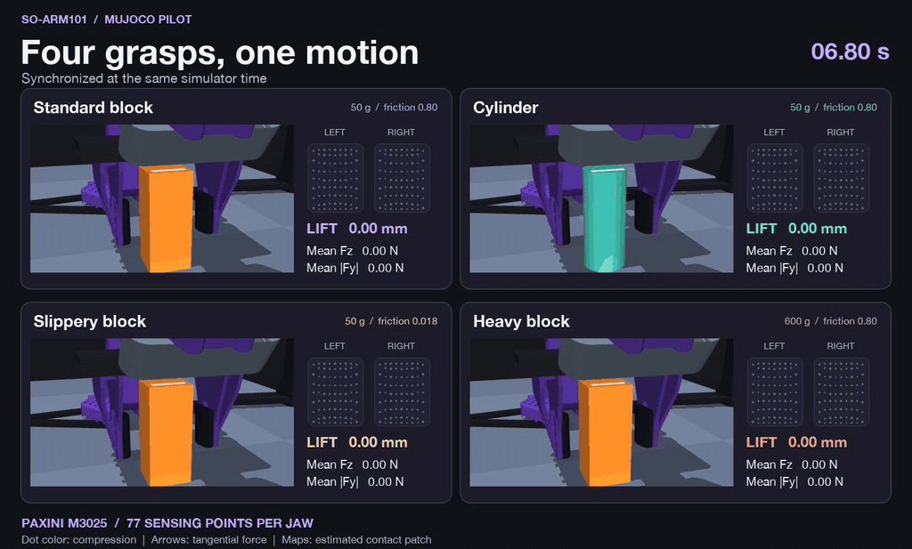
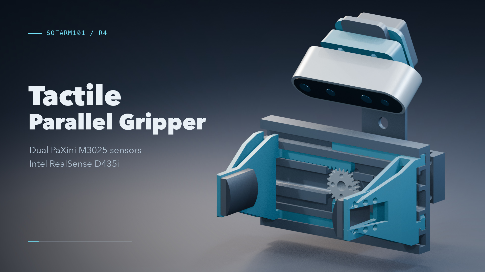
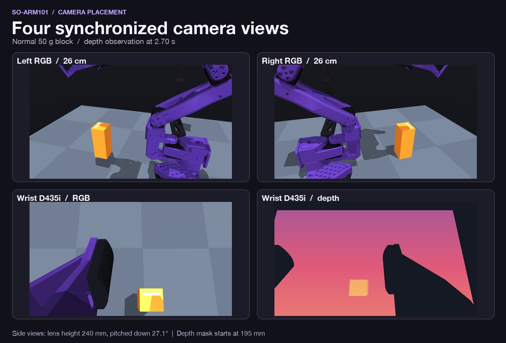

# SO-ARM101 Tactile Picking

**Can a robot tell when to regrasp and when to move on?**

A MuJoCo pilot and a printable SO-ARM101 sensor rig for studying that decision after a short lift. The rig combines parallel jaws, two PaXini PX-6AX GEN3 M3025 pads, a wrist-mounted D435i, and two fixed RGB views.

[한국어 연구 기록](docs/research-notes.ko.md) · [Experimental plan](docs/experimental-plan.md) · [CAD and assembly](cad/README.md) · [Videos and print pack](https://github.com/jhyeong687/so101-tactile-picking/releases/tag/v0.1.0)

## Synchronized pilot

All four conditions replay the same motion. Dot color encodes normal force and arrows show in-plane force. The map estimates the contact patch from the simulation geometry. The table uses the [shared 8.90 s checkpoint](media/grasp-comparison.jpg).

| Condition | Mass | Pad friction | Object rise | Mean Fz per jaw | Mean abs. Fy per jaw |
| --- | ---: | ---: | ---: | ---: | ---: |
| Standard block | 50 g | 0.80 | 11.60 mm | 5.29 N | 0.24 N |
| Cylinder | 50 g | 0.80 | 11.47 mm | 5.15 N | 0.24 N |
| Slippery block | 50 g | 0.018 | 0.00 mm | 5.29 N | 0.09 N |
| Heavy block | 600 g | 0.80 | 0.93 mm | 5.39 N | 2.70 N |

The standard and slippery blocks had nearly identical squeeze force and different lift outcomes. The 600 g block changes the load at the same nominal friction as the standard block. These are four simulated cases, with one scripted trajectory per case. Agent decision quality and hardware performance are still open measurements.

[Side-by-side video](https://github.com/jhyeong687/so101-tactile-picking/releases/download/v0.1.0/so101-four-grasps.mp4) · [Full trial traces in CSV](data/trial-traces.csv) · [77-point vectors at 40 checkpoints](data/tactile-pilot.json) · [Data dictionary](data/README.md)

## Hardware and camera views

**[Watch the 24-second R4 gripper design film](https://github.com/jhyeong687/so101-tactile-picking/releases/download/v0.1.0/so101-gripper-r4.mp4).** The film shows the parallel-jaw design and PaXini holder in CAD. The R7 simulator incorporates the wrist and 26 cm RGB mount updates that followed the film.

| What to inspect | Files |
| --- | --- |
| RGB mounts, each 260 mm off center and 240 mm above the table | [STLs](cad/rgb-26cm/STL) · [Color STEP](cad/rgb-26cm/mount-assembly.step) · [Print pack](https://github.com/jhyeong687/so101-tactile-picking/releases/download/v0.1.0/so101-rgb-26cm-print-pack.zip) |
| Wrist D435i bridge, forearm PaXini board saddle, and M1.6 fit coupon | [STLs and editable STEP files](cad/wrist-and-fit) |
| Matched frames from both side RGBs and the wrist RGB/depth | [Synchronized camera panel](media/camera-views.jpg) |
| Fit, optical pose and 51 CAD path samples | [Clearance data](data/cad-clearance.json) · [Assembly notes](cad/README.md) |

See the four camera feeds at the same instant

## Run locally

    python -m venv .venv
    source .venv/bin/activate
    python -m pip install -r simulation/requirements.txt
    python simulation/sim.py --verify --physics-only
    python simulation/sim.py --port 8770

Open [localhost:8770](http://127.0.0.1:8770/). The dashboard opens at the lift checkpoint. Inspect contact-point and estimated contact-patch maps, compare the four trials, or export the current tactile frame. On systems with an OpenGL context, omit `--physics-only` to check camera rendering too. [Simulator controls and API](simulation/README.md)

`GET /agent_tactile` returns time-stamped force arrays, pad resultants and torques, contact state, center of pressure, and short-window changes. The downloadable logs include separate simulation labels for scoring. Regenerate them with `python scripts/record_trials.py`. The public scene uses simplified visuals for six upstream gripper parts and retains the pad collision meshes and simulated dynamics.

## Research direction

1. **Measure observability.** Hold motion, appearance and timing fixed. Vary mass, surface friction and grasp location independently. Measure which signals predict a recoverable grasp.
2. **Test the recovery decision.** Compare RGB and robot state, a force-threshold controller, and policies that choose a short second probe using tactile history. Score false skips, drops, time per useful pick and unnecessary probes on held-out objects.
3. **Transfer to hardware.** Calibrate signs and forces on both mounted pads, synchronize camera and robot time, and record controlled grasp, slip and regrasp trials.

The hypothesis is that touch helps a robot decide **which small physical test to try next**. [Detailed experiment and evaluation protocol](docs/experimental-plan.md)

Lee Jin Hyeong · 23 November 2026 · Simulation and CAD pilot

[Prior VTLA work](https://github.com/jhyeong687/VTLA) · [Sources and asset credits](docs/sources.md)
