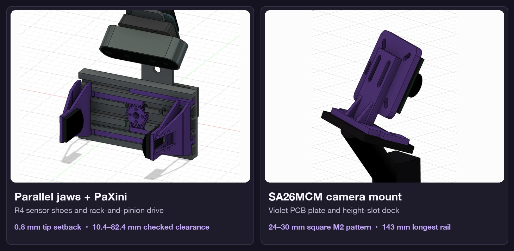
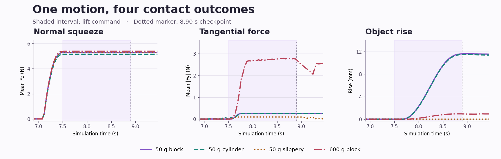
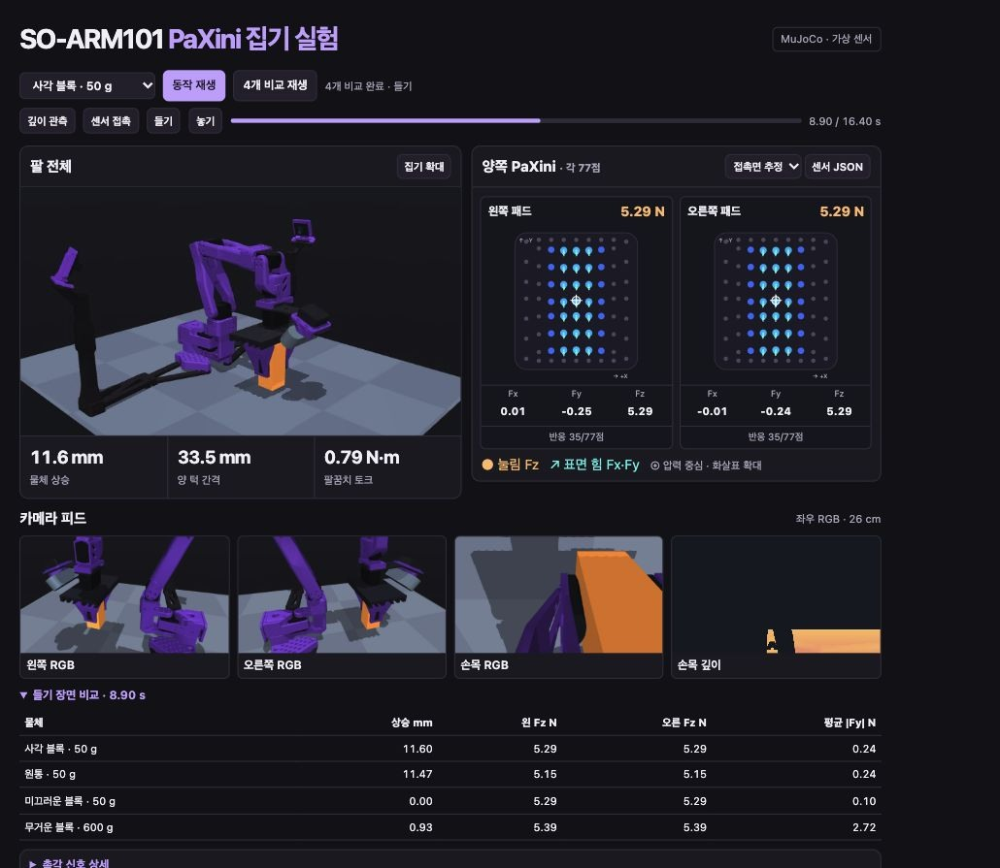

# Tactile Probing for Grasp Recovery

**A PaXini-equipped SO-ARM101 testbed for deciding when to regrasp or skip**

A failed lift can come from poor contact, a slippery surface, or a load the arm cannot raise in its current posture. This pilot builds the gripper, camera rig, and measurement pipeline needed to study those cases under the same motion.

**[Download the reproduction kit](https://github.com/jhyeong687/tactile-grasp-recovery/releases/download/v0.2.0/so101-tactile-recovery-kit.zip)** · [Get started](docs/quickstart.md) · [한국어 연구 기록](docs/research-notes.ko.md) · [Videos and print files](https://github.com/jhyeong687/tactile-grasp-recovery/releases/tag/v0.2.0)

## How the rig comes together

The Fusion motion begins with the R4 parallel jaws and tactile pads. It then seats the R7 rails, split masts and camera mounts on the SO-ARM101 base. The 24-second R4 design film covers the gripper from additional angles. [Fusion assembly MP4](https://github.com/jhyeong687/tactile-grasp-recovery/releases/download/v0.2.0/so101-fusion-assembly.mp4) · [R4 design film](https://github.com/jhyeong687/tactile-grasp-recovery/releases/download/v0.2.0/so101-gripper-r4.mp4)

| Design iteration | Work completed | Verification |
| --- | --- | --- |
| **R4 tactile jaws** | Fit two M3025 pads to a rod-free rack-and-pinion gripper. Join the two forward screw supports to form a rectangular cable window. | In CAD, the bridge tip is 0.8 mm behind the sensor face. The checked sensor-face gap is 10.4–82.4 mm. |
| **R5 wrist and cable routing** | Keep the D435i on the wrist, lighten its bridge and compare wrist-side and forearm PaXini box routes. | Bridge volume 14.73 → 8.62 cm³. CAD mass estimates for the two tool configurations were about 307 g and 281 g. Actual masses and motor limits require a bench check. |
| **R7 fixed RGB mounts** | Add black rails and split masts with violet mounts for the left and right SA26MCM cameras. | Each lens is 260 mm off center, 240 mm above the table and pitched down 27.1°. The longest new print is 143 mm. No robot–mount intersections appeared in 51 sampled CAD poses. |

[26 cm STLs](cad/rgb-26cm/STL) · [Color STEP assembly](cad/rgb-26cm/mount-assembly.step) · [Wrist and fit-check parts](cad/wrist-and-fit) · [Assembly order and fasteners](cad/README.md) · [CAD checks](data/cad-clearance.json)

## Four grasps on one time axis

The same scripted grip and lift runs in four conditions. Colors and arrows indicate the estimated contact patch and in-plane force. The lift command spans 7.50–8.90 s. The table uses the [shared 8.90 s frame](media/grasp-comparison.jpg).

| Condition | Mass | Pad friction | Object rise | Mean Fz per jaw | Mean abs. Fy per jaw |
| --- | ---: | ---: | ---: | ---: | ---: |
| Standard block | 50 g | 0.80 | **11.60 mm** | 5.29 N | 0.24 N |
| Cylinder | 50 g | 0.80 | **11.47 mm** | 5.15 N | 0.24 N |
| Slippery block | 50 g | 0.018 | **0.00 mm** | 5.29 N | 0.09 N |
| Heavy block | 600 g | 0.80 | **0.93 mm** | 5.39 N | 2.70 N |

In this pilot, the standard and slippery blocks have the same rounded squeeze force at the checkpoint, yet only the standard block lifts. The heavy block applies more tangential force at the same nominal friction as the standard block. A future policy comparison will test how much those cues help it choose a recovery action. Each row here comes from one simulated episode.

[Parallel video](https://github.com/jhyeong687/tactile-grasp-recovery/releases/download/v0.2.0/so101-four-grasps.mp4) · [1,644 time samples in CSV](data/trial-traces.csv) · [40 tactile snapshots in JSON](data/tactile-pilot.json) · [Data schema](data/README.md)

## What the simulator shows

<strong>Live dashboard · robot, dual tactile maps, four cameras, and comparison table</strong>

The live replay averages force over each playback step. The numerical table above uses the same deterministic checkpoint procedure as the downloadable data.

| Signal | How to read it |
| --- | --- |
| **Two PaXini pads** | Each pad reports 77 three-axis vectors. The dashboard shows normal force, tangential direction, center of pressure, net torque, and force changes over about 100 ms. |
| **Point-based map and estimated contact patch** | MuJoCo represents a broad contact with a few points. The alternative view spreads its force within the nearby surface region and preserves net force. The geometry-based estimate is a visualization option. |
| **Left and right RGB** | The side cameras record the same action from the documented ±260 mm mount positions. |
| **Wrist RGB and depth** | Compare the approach and grasp views. Simulated D435i depth under 195 mm is masked, so close grasps often need the earlier depth observation and the live tactile signal. |

[Four matched camera images](media/camera-views.jpg) · [Expanded tactile signal table](media/mujoco-signal-detail.jpg) · [Simulator API and controls](simulation/README.md)

## Download and run

Download and extract the [reproduction kit](https://github.com/jhyeong687/tactile-grasp-recovery/releases/download/v0.2.0/so101-tactile-recovery-kit.zip), or clone this repository. From its root, in a Python environment:

    python -m pip install -r simulation/requirements.txt
    python simulation/sim.py --verify --physics-only
    python simulation/sim.py --port 8770

Open [the local dashboard](http://127.0.0.1:8770/). Use **4개 비교 재생** to replay all four conditions or **촉각 분포 표시** to change tactile maps. The exported sensor JSON can be inspected without a robot. Run `python scripts/record_trials.py --output replay-data` to regenerate the logs separately. The kit includes the [STLs and STEP](cad/README.md), a [Korean assembly guide](cad/rgb-26cm/assembly.ko.md), and the [quick start guide](docs/quickstart.md).

The public simulator uses simplified visuals for six upstream gripper parts and retains the analyzed pad collision meshes and dynamics. The original ggao50 hardware source is linked in the credits, along with the constraints on redistribution. [Source and asset credits](docs/sources.md)

## Next research steps

1. **Establish recoverability labels.** Present visually identical shells with independent changes in mass, friction and initial grip location. Run a predeclared set of bounded regrasp attempts.
2. **Measure what touch adds.** Compare RGB and robot state, a normal-force threshold, a fixed probe, and a policy that chooses its next tactile probe. Permute tactile histories as a control.
3. **Transfer to the bench.** Calibrate the two pads and camera poses, synchronize timestamps, and compare measured contact and slip transients against simulated traces. Evaluate false skips, drops and successful picks per minute on held-out items.

[Full experimental plan](docs/experimental-plan.md) · [Decision and design log in Korean](docs/research-notes.ko.md) · [Prior VTLA work](https://github.com/jhyeong687/VTLA)

Lee Jin Hyeong · November 2026 · CAD and simulation pilot
