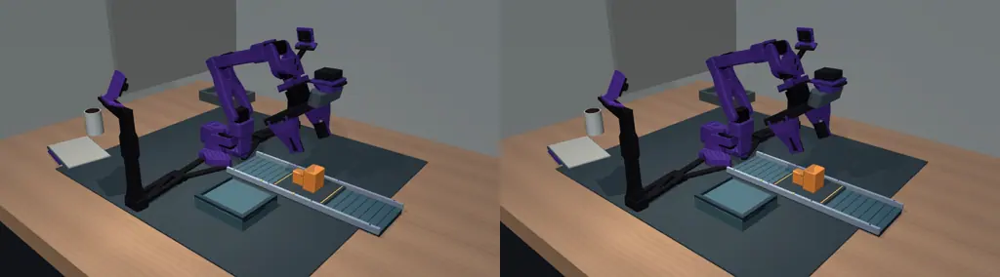

# 같은 물체, 다른 벨트 속도

SO-ARM101 R7의 양쪽 PaXini와 카메라 설정을 사용해, 첫 짧은 들기 이후 **지금 다시 잡기**, **80 mm 가까운 지점에 온 뒤 잡기**, **통과**를 비교했다. 인덱싱 캐리어는 픽업 때 정지하고 구간 사이를 움직인다. 손을 열고 인계 트레이와 부품이 접촉한 뒤 안정되면 인계로 기록했다.



왼쪽은 25 mm/s에서 가까워지기를 기다렸다가 옮긴 시행, 오른쪽은 55 mm/s에서 같은 물체를 보낸 시행이다. 두 영상 모두 Astra가 반환한 선택과 그립 설정을 실행한 MuJoCo 장면이다. [저속 영상](../media/conveyor/stepped-loaded-slow-astra.mp4) · [고속 영상](../media/conveyor/stepped-loaded-fast-astra.mp4)

## 8개 조건에서의 결과

| 정책 | 추론 동안 멈춘 시계에서 정시 인계 | 측정한 추론 시간을 더한 정시 인계 |
| --- | ---: | ---: |
| 중심을 항상 다시 잡기 | 6/8 | 6/8 |
| 토크·전단력 기준 규칙 | **7/8** | **7/8** |
| GPT-6.2 Astra `xhigh` | 6/8 | 0/8 |

같은 부품 4개를 두 속도에서 반복했다. 세 가지 비대칭 외형에는 단차형, ㄱ자형, 폭이 달라지는 테이퍼형 외곽을 사용했다. 단차 부품 두 개는 외형이 같고 내부 하중과 마찰만 다르다. 모든 정책은 같은 10 mm 들기 명령과 새 관찰에서 시작했다. 속도별 남은 시간은 공통 접촉 종료 후 **6.60 s / 3.00 s**로 정했다. 가까운 지점까지 이동과 인계에는 **5.84 s / 약 4.09 s**, 즉시 인계에는 **2.64 s**가 들었다.

- **같은 단차 부품에서 선택이 바뀌었다.** 350 g 조건에서 Astra와 규칙 모두 저속에는 기다려 인계하고, 고속에는 넘겼다. 시험한 파지 위치·닫힘 조합 중 고속에서 정시 인계한 것이 없었다.
- **파지 위치를 바꾸면 실제 결과가 달라졌다.** ㄱ자 부품에서 왼쪽 또는 중심으로 잡으면 인계됐고 오른쪽은 두 닫힘 설정 모두 실패했다. Astra는 느린 속도에서 왼쪽을 고른 뒤 인계했다. 빠른 속도에서는 넘겼지만 규칙이 중심을 다시 잡아 인계했다. [ㄱ자 부품의 고속 인계](../media/conveyor/elbow-fast-force_rule.mp4)
- **Astra는 신속한 제어 경로에 넣기 어려웠다.** Codex CLI 호출의 실제 경과 시간은 **17.185–45.314 s**, 중앙값 **27.132 s**였다. 호출 오버헤드를 포함한 값이다. 실제 마감에 미치는 영향을 보기 위해 각 시행의 인계 시간에 실측 경과 시간을 더했다.
- **이 결과는 PaXini 효과를 확립하지 않는다.** 이 8개 조건에서 규칙의 전단력 조건을 빼고 관절 토크 임계값만 써도 같은 행동이 나왔다. 두 합성 센서 신호가 이 표본에서는 같은 사례를 가리킨다. Astra의 전체 촉각 제거 조건과 실제 벨트에서의 연속 추적은 후속 실험으로 남아 있다.

## 모델과 제어기

`gpt-6.2-astra`와 `xhigh` 설정으로 **모델 호출 8회**를 실행했다. 모델은 같은 부품의 카메라 두 뷰, 공통 들기 뒤 양쪽 힘 집계, 그리퍼 간격, 토크, 남은 시간을 받았다. 질량, 정답 접촉 위치, 채점기 상태는 모델 입력에서 제외했다. 상단 카메라 일부를 로봇이 가렸으므로 충분한 상면 정보가 주어졌다고 볼 수 없다. 사전 보정에서 정한 단순 규칙의 임계값은 같은 치구군에서 나온 탐색적 비교다.

모델 응답의 행동과 파지 위치 **−14/0/+14 mm**, 목표 닫힘 간격 **18/24 mm**를 검증한 뒤 실행했다. 실제 세부 자세, 트레이 이동과 IK는 하네스가 계산했다. 한 물체에서 모델 호출 한 번을 사용한 제약된 조작 실험이다. 브라우저의 실시간 실행은 저장된 정책 응답을 MuJoCo에서 재실행한다. 읽기 화면의 접촉면 추정은 합성 물체 표면의 근사에 힘을 다시 배분한 표시다.

## 재현

```bash
python -m pip install -r simulation/requirements.txt
python simulation/conveyor/evaluate.py --output conveyor-run --responses data/conveyor-pilot/astra-calls.json
cp simulation/conveyor/index.html conveyor-run/index.html
python simulation/conveyor/serve.py conveyor-run --calls data/conveyor-pilot/astra-calls.json
```

[로컬 대시보드](http://127.0.0.1:8776/). 모델을 다시 호출하려면 `--responses ...` 대신 `--astra`를 쓰고 Codex CLI를 ChatGPT에 로그인한다. 원래 R7 메시가 있는 경우 해당 명령에 `--robot-scene /path/to/R7/scene.xml`을 추가할 수 있다. FFmpeg 영상 생성은 `python simulation/conveyor/render.py conveyor-run/results.json --output conveyor-videos`로 실행한다. [정책별 결과](../data/conveyor-pilot/results.json) · [Astra 선택·입력 수치·호출 시간](../data/conveyor-pilot/astra-calls.json) · [모델에 준 이미지](../data/conveyor-pilot) · [후속 촉각 쌓기 실험](tactile-stacking-protocol.ko.md)
