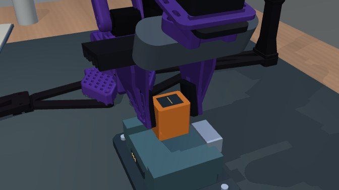
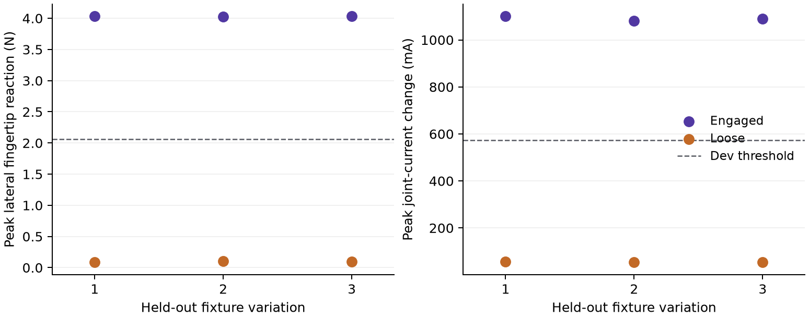

# 높이 차이를 없앤 걸쇠 검사

손잡이 겉모습이 같은 두 치구를 SO-ARM101 R7이 검사한다. 목표는 입고 시점의 걸쇠 상태를 맞히면서 초기 상태를 손을 뗄 때까지 보존하는 것이다. **초기 상태가 맞고 검사 중 체결 상태가 한 번도 바뀌지 않은 시행**을 성공으로 센다.

[](../media/latch/flush/r4-contact.mp4)

## 세팅

- R7 로컬 장면을 사용했다. 양쪽 랙은 출력용 R4 CAD의 형상이며, 레일·지지대·서보 연결판·피니언도 상세 메시로 렌더했다. 공개 장면에는 그 여섯 부품의 간략 외형이 들어 있다. 두 장면에서 패드 접촉력과 로봇 궤적이 저장 정밀도에서 일치하는지 별도로 재생했다. [R7 메시 감사 기록](../data/latch-pilot/flush-inspection/local-r7-mesh-manifest.json) · [에셋 출처](sources.md)
- 손잡이 중심은 양쪽 상태에서 **[202, 0, 64] mm**다. 상태가 다른 한 쌍을 초기화했을 때 좌우 RGB, 손목 RGB, 손목 깊이 표시 화면의 픽셀과 색칠 전의 원시 깊이 배열이 일치했다. 동일 높이에서 서로 다른 결과가 나도록 내부 슬라이더가 정상 상태에서만 손잡이의 유격을 제한한다. 숨겨진 슬라이더 위치는 채점에 사용한다. [관측 및 물리 재생 검증](../data/latch-pilot/flush-inspection/baseline-verify-native.json)
- 센서 입력은 좌우 RGB, 손목 RGB, 손목 깊이다. 초기 관측 자세를 올려 D435i 모델의 195 mm 근거리 한계 밖에서 손잡이를 본다. 화면에는 별도로 관람용 사선 카메라와 양쪽 패드 시각화가 있다.
- 물체 중심을 보정해 둔 손잡이 주변에서 Astra가 X·Z 접촉 위치, 이동 방향·거리, 턱 간격을 정한다. 동일한 드라이버가 IK로 접근·집기·이동·유지·복귀·열기·후퇴를 실행한다. 각 응답에서 한 동작을 고르거나, 처음부터 또는 최대 두 번 탐침한 뒤 정상·덜 잠김·보류를 고른다. 촉각을 켜면 관절 위치·모의 전류 및 카메라와 함께 패드 합력과 활성 측정점의 3축 힘을 준다. 촉각을 끄면 동일한 카메라·관절 위치·모의 전류를 준다.
- 모든 조건에서 마찰, 손잡이의 측면 강성 및 내부 스프링 계수가 다른 세 조합에 정상과 불량을 각각 적용한다. 고정 규칙의 임계값은 평가에 포함되지 않는 개발 치구 한 쌍의 중간값이다. 아래로 9 mm 누른 양성 대조에서는 덜 잠긴 걸쇠가 한 번 체결됐으며, 손을 떼고도 체결을 유지했다. 채점기는 1 ms 스텝에서 일시적인 상태 전환까지 기록한다. [개발 치구와 양성 대조 기록](../data/latch-pilot/flush-inspection/native-rules/calibration.json)

## 비교 결과

| 조건 | 두 상태 중 정답이며 상태 보존 | 불량 검출 | 상태 전환 시행 | 시행당 시뮬레이션 시간 |
| --- | ---: | ---: | ---: | ---: |
| 고정 탐침 · PaXini 합력 | 6/6 | 3/3 | 0/6 | 4.28 s |
| 고정 탐침 · 모의 관절 전류 | 6/6 | 3/3 | 0/6 | 4.28 s |

Astra 촉각 켬·끔 비교를 같은 상세 장면에서 실행하고 있다. 모델 호출이 실패한 기록은 로봇이 보류를 선택한 기록과 구분한다.

양쪽 고정 규칙에 같은 2 mm 측면 탐침을 주었다. 힘 규칙은 탐침 중 최대 진행 방향 합력을 쓰며, 관절 전류 규칙은 집기가 끝날 때의 관절 전류 벡터 대비 최대 변화량을 쓴다.

| 고정 규칙 | 개발 임계값 | 평가 중 덜 잠김 | 평가 중 잠김 |
| --- | ---: | ---: | ---: |
| PaXini 합력 | 2.0626 N | 0.0844–0.1056 N | 4.0293–4.0332 N |
| 모의 관절 전류 | 573.15 mA | 53.52–57.15 mA | 1080.86–1100.75 mA |



## 해석

두 고정 규칙은 현재 치구의 측면 유격을 충분히 구분했다. 모의 전류에는 관절별 바이어스·시간 드리프트·5 mA 양자화를 넣었고, 장착 모터의 실측값은 사용하지 않았다. 촉각의 77점 벡터도 MuJoCo 접촉력을 패드 좌표에 투영한 값이다. 이 파일럿의 비교 범위는 단일 형상의 세 물성 변화다. 신호가 겹치는 치구나 실제 장비에서의 우위는 추가 검증이 필요하다.

## 재현

```bash
python -m pip install -r simulation/requirements.txt
python simulation/latch/verify_inspection.py data/latch-pilot/flush-inspection/native-rules
python simulation/latch/inspection.py --rule-only --output flush-rules
python -m http.server 8896 --bind 127.0.0.1 --directory flush-rules
```

모델 비교는 `--rule-only`를 빼고, `gpt-6.2-astra`의 `xhigh` 설정을 반환하는 Codex app-server가 있는 환경에서 실행한다. `R7_CODEX_BIN`으로 클라이언트 실행 파일을 지정할 수 있다. 상세 장면을 보유한 경우 `--scene /path/to/R7/scene.xml`을 추가한다. 저장된 동작은 `replay_inspection.py`로 로컬 대시보드에서 다시 볼 수 있으며 이 재생은 모델을 호출하지 않는다. 결과표의 실시간 표시에는 4개 카메라, 패드별 77점, 접촉점 및 접촉면 추정 모드가 있다.

[데이터 폴더와 원본 25 Hz 양쪽 PaXini 시계열](../data/latch-pilot/flush-inspection/) · [학술 평가 계획](diagnose-before-repair.ko.md)
