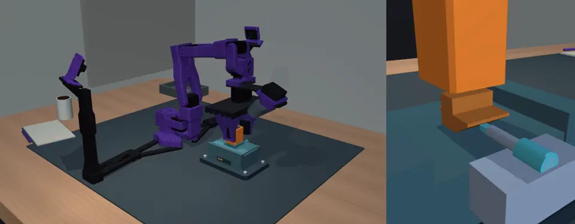

# 흔들어 검사하고, 눌러 체결하기

표준 SO-ARM101 R7 장면에 스프링 볼트, 황동 램프, 측면 유격이 있는 치구를 붙였다. 같은 그리퍼로 뚜껑의 손잡이를 잡고 세 가지 동작을 각각 실행했다. 전환은 MuJoCo의 접촉과 스프링으로 일어난다. 걸쇠 상태 판정 기록은 움직임을 만드는 코드와 독립적으로 뚜껑 및 볼트의 위치에서 읽는다.

[](../media/latch/loose-press.mp4)

| 초기 상태 | 시험 동작 | 기본 장면에서 관측한 신호 | 손을 뗀 뒤 |
| --- | --- | --- | --- |
| 덜 잠김 | ±1.5 mm 흔들기 | 앞 방향 구간 합성 접선력 `abs(Fx)` 최대 **0.0888 N** | 덜 잠김 |
| 잠김 | ±1.5 mm 흔들기 | 같은 구간 최대 **4.0750 N** | 잠김 |
| 덜 잠김 | 누르기 | **2.388 s**에 볼트가 황동 램프 위쪽으로 복귀 | 잠김 |
| 잠김 | 누르기 | 상태 전환 0회 | 잠김 |

[덜 잠김 · 흔들기](../media/latch/loose-wiggle.mp4) · [잠김 · 흔들기](../media/latch/engaged-wiggle.mp4) · [덜 잠김 · 누르기](../media/latch/loose-press.mp4) · [잠김 · 누르기](../media/latch/engaged-press.mp4)

### 무엇을 확인했나

- 기본 조건의 두 힘값 중간인 **2.0819 N**을 경계로 잡았다. 로봇 접근 오프셋, 볼트 스프링 강성, 그리퍼 마찰을 바꾼 다섯 조합에서 흔들기 **10/10** 동안 초기 상태가 유지되고, 최초 체결 상태 분류도 **10/10**이었다. 덜 잠긴 쪽은 **0.082–0.100 N**, 잠긴 쪽은 **4.061–4.089 N**이었다. 각 조합에서 두 상태를 모두 실행했다.
- 다섯 조합의 덜 잠긴 치구는 누르기 **5/5**에서 한 번만 전환했고 그리퍼를 열고 물러난 뒤에도 체결 상태였다. 기본 장면도 전환 뒤 볼트와 램프가 계속 접촉했다. **같은 누르기 명령을 주되 볼트를 후퇴시켜 둔 대조군**에서는 손을 떼자 뚜껑이 원래 높이로 돌아왔다. 동작 없이 대기한 12회에서는 자발 전환이 없었다.
- 잠긴 상태에서는 아래쪽 가이드가 뚜껑의 측면 움직임을 막는다. 힘 차이는 이 치구가 제한하는 유격의 차이다. 눌렀을 때 손이 하중으로 바깥쪽에서 밀리는 보정을 위해 하강과 함께 3 mm 중심 보정 명령을 적용했다. 그리퍼 접근과 누르기는 보정된 궤적을 사용한다.
- 기본 6회, 변동 조건 30회, 볼트 후퇴 대조 1회로 총 37회다. 변동 조건은 한 치구 모델에서 정한 소규모 감도 점검이다. 현재 치구는 두 상태의 뚜껑 높이가 약 **6.25 mm** 다르다. 외형만 보아 두 상태가 얼마나 구분되는지와 실제 PaXini 신호는 후속 검증 항목이다. 힘의 크기는 단단한 가이드 및 가상 마찰 조건에 따른 시뮬레이션 결과다. Astra의 행동 선택은 이 파일럿에서 평가하기 전이다.

### 재현과 화면

```bash
python -m pip install -r simulation/requirements.txt
python simulation/latch/run.py --output latch-run
# FFmpeg이 설치된 경우, 20 fps 영상과 대시보드를 함께 생성한다.
python simulation/latch/run.py --output latch-run --render
python simulation/latch/serve.py latch-run
```

[로컬 대시보드의 실시간 실행 보기](http://127.0.0.1:8774/?live=1). 대시보드는 전체 팔, 걸쇠 단면, 좌우 RGB, 손목 RGB·깊이, 양쪽 PaXini 각각 77점의 힘과 전단 벡터를 동일한 시뮬레이션 시간에 보여준다. 접촉점 기반은 충돌력이 가까운 taxel에 분배된 값이고, 접촉면 추정은 접촉 기하를 사용해 힘을 재분배한 표시다. 실험이 끝나면 촉각 패널에 최대 접촉 구간의 시각과 기록이 남는다. 현재 프레임으로 전환하면 손을 뗀 뒤의 값을 확인할 수 있다. 재실행 중에는 시뮬레이션 프레임을 스트리밍한다. 책상, 매트, 소품과 외관용 모서리 마감은 렌더링 전용이다.

기존 로컬 R7 원본을 보유한 경우 두 명령에 `--robot-scene /path/to/R7/scene.xml`을 추가해 원래 메시를 사용한다. 공개본과 로컬 원본으로 요약 및 명목 시계열이 동일하게 재현되는 것을 비교했다. [공개 로봇 메시 출처](sources.md) · [MuJoCo 조명 및 재질](https://mujoco.readthedocs.io/en/latest/XMLreference.html)

[실행 결과 JSON](../data/latch-pilot/results.json) · [50 Hz 명목 시계열 CSV](../data/latch-pilot/nominal-traces.csv) · [77×2점 센서 벡터와 집계값 JSON.gz](../data/latch-pilot/replays.json.gz) · [전체 연구계획](tactile-inspection-protocol.ko.md)
