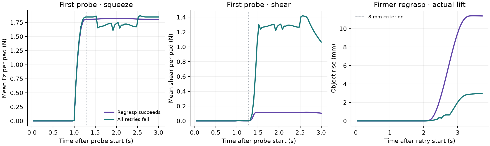

# Regrasp or Skip? · Bounded recovery pilot

This pilot asks whether a short first lift gives a controller enough information to choose a useful recovery. We used the SO-ARM101 MuJoCo model with two simulated PaXini pads and two fixed RGB cameras.

**What Qwen did.** Qwen read RGB frames and, depending on the input condition, summaries of arm and tactile signals. It returned an action and a short explanation. The harness generated the MuJoCo trajectories independently, mapped the returned action to a recorded branch, and scored the result. This is an offline evaluation of action selection. Live model-to-controller execution and physical robot evaluation are open experiments.

## Matched trials and recovery labels

We ran 10 calibration episodes and 26 evaluation episodes. Every episode used the same orange shell geometry. We varied its starting offset, mass, and pad friction. The evaluation used six starting positions held apart from the three calibration positions. Mass, friction, exact object pose, and the geometry-based contact visualization were omitted from the model inputs.

The robot took a 3.0 s pinch, lift, and hold. It then lowered and opened the jaws and saved a MuJoCo state. Three retries started from that same state. One moved 18 mm toward the base, one moved 18 mm away, and one used a firmer pinch at the same position. A policy could select at most one retry.

A useful lift kept the object at least 8 mm above its starting height, within 20° of upright, clear of the table, and below sustained simulated arm saturation at the sampled end of the hold. Scoring used the final six 40 ms samples. The labels were **continue** if the first lift passed, **regrasp** if an allowed retry passed, and **skip** if all three retries failed. The skip label is relative to this arm, task, and retry budget.

| Evaluation label | Episodes |
| --- | ---: |
| Continue | 5 |
| Regrasp | 9 |
| Skip | 12 |

## Cases where sensing changes what the robot can tell

In two groups of four trials, the post-probe RGB images were byte-identical within each group, and every arm, RGB-derived, and tactile summary field was identical. The first grasp had missed the shell. The same directional retry succeeded on two of four trials in each group. A deterministic policy using only these inputs cannot separate those trials before collecting more evidence. The saved hashes and case IDs identify both groups.

In another matched pair, both first lifts barely moved the object. Mean squeeze per pad at the end of the hold was **1.81 N** versus **1.85 N**, while mean tangential force was **0.11 N** versus **1.15 N**. The firmer retry held the objects **11.37 mm** and **2.94 mm** above their starting heights, respectively. Mass and friction both differ in this pair. The traces illustrate a candidate cue for further testing.



## Policy results on the same 26 evaluation episodes

The two models received the same action vocabulary and ran locally with temperature 0. Aligned and shuffled tactile conditions shared the same RGB images and arm observations. Shuffling used a fixed within-scene permutation. The model never received the scenario ID or the scoring fields.

| Policy | Useful picks | Correct decision class | False skips | Failed retries | False continues | Invalid replies |
| --- | ---: | ---: | ---: | ---: | ---: | ---: |
| Vision-based rule, directional retry | 13 | 13 | 0 | 12 | 1 | 0 |
| Normal-force rule | 8 | 13 | 4 | 9 | 1 | 0 |
| Fixed firmer retry | 8 | 13 | 0 | 17 | 1 | 0 |
| Adaptive rule, vision + contact + elbow load | **13** | **16** | **0** | **9** | 1 | 0 |
| Qwen2.5-VL 7B, pre-contact RGB | 5 | 9 | 0 | 11 | 10 | 0 |
| Qwen2.5-VL 7B, post-probe RGB + arm | 5 | 5 | 0 | 0 | 21 | 0 |
| Qwen2.5-VL 7B, aligned tactile | 5 | 7 | 2 | 0 | 17 | 0 |
| Qwen2.5-VL 7B, shuffled tactile | 5 | 7 | 2 | 0 | 17 | 0 |
| Qwen2.5-VL 7B, aligned tactile with guard | 11 | 16 | 2 | 7 | 1 | 0 |
| Qwen2-VL 2B, aligned tactile | 0 | 0 | 0 | 0 | 0 | 26 |

A correct decision class can still select a failed retry direction. Useful picks count only lifts that actually met the simulator criterion. The 2B model omitted the required evidence field on all 26 tactile trials. The harness recorded those replies and withheld a decision.

The 7B model picked the same five episodes with aligned and shuffled tactile data. The adaptive rule kept all 13 picks from the directional vision rule and reduced retries from 20 to 17. Its mean modeled probe-and-retry time fell from 7.28 s to 6.85 s per item. These times exclude model inference, setup, and transfer to a bin. The guarded 7B policy was an exploratory replay on the same episodes. It used the fallback rule 16 times, bringing 5 useful picks to 11. The rule by itself picked 13.

## Reproduce the pilot

Run these commands from the repository root. The RGB exports require a MuJoCo-compatible OpenGL renderer.

```bash
python -m pip install -r simulation/requirements.txt
python scripts/run_recovery_pilot.py --output pilot-log
python scripts/evaluate_recovery_pilot.py --data pilot-log --output pilot-rules
```

On Apple Silicon, use `mlx-vlm==0.6.3` to replay the model conditions. Pass a local snapshot path to run a specific cached model revision.

```bash
python scripts/evaluate_recovery_pilot.py --data pilot-log --output pilot-qwen7b \
  --model mlx-community/Qwen2.5-VL-7B-Instruct-4bit
python scripts/analyze_recovery_pilot.py --data pilot-log --results pilot-qwen7b \
  --output pilot-qwen7b/diagnostics.json
```

For exact model comparisons, replay the saved `model-responses.jsonl` with `--responses`. The data archive contains both checkpoint revisions, the prompt, the images and features presented, raw responses, branch outcomes, and the 154 three-axis readings per recorded sample. Policy code consumes observations first; outcome files are loaded for calibration of rules and scoring. The scripts and the calibration split are part of the repository.

[Raw run bundle](https://github.com/jhyeong687/tactile-grasp-agent/releases/download/v0.3.0/tactile-agent-pilot-data.zip) · [7B summary](../data/recovery-pilot/summary-qwen25-7b.json) · [2B summary](../data/recovery-pilot/summary-qwen2-2b.json) · [Matched-case diagnostics](../data/recovery-pilot/diagnostics.json)

The next comparison should let the controller request a low-cost diagnostic motion before deciding. Use a new evaluation set and keep the allowable motion budget the same across fixed and adaptive probe policies.
