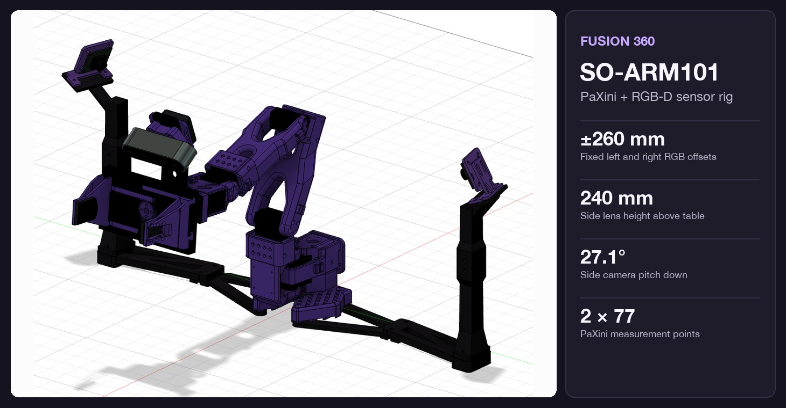

# 촉각 탐침을 이용한 파지 회복

2026년 11월 22–23일에 진행한 CAD 개선과 MuJoCo 파일럿이다. 이전 [VTLA 프로젝트](https://github.com/jhyeong687/VTLA)에서 쓰던 PaXini 센서 두 개를 SO-ARM101에 다시 붙여, 파지 직후의 판단을 실험할 수 있게 만들었다.

[재현 키트 받기](https://github.com/jhyeong687/tactile-grasp-recovery/releases/download/v0.2.1/so101-tactile-recovery-kit.zip) · [실행 가이드](quickstart.md) · [Fusion 조립 영상](https://github.com/jhyeong687/tactile-grasp-recovery/releases/download/v0.2.1/so101-fusion-assembly.mp4)

## 연구 질문

처음에는 IK와 웨이포인트 구현 언어를 바꾸거나, RGB 카메라 위치와 깊이 입력을 비교하는 아이디어가 있었다. 이후 실험을 **같은 팔이 한 번 집기에 애매하게 실패했을 때 어떻게 다시 잡거나 건너뛰는가**에 집중했다.

겉모습이 같은 물체라도 약한 접촉, 미끄러짐, 하중 변화가 생기도록 조건을 바꾼다. 에이전트가 무슨 정보를 얻기 위해 다음 짧은 동작을 선택했고, 그 결과가 결정을 바꿨는지 본다. 같은 모델과 도구를 두고 촉각 시계열을 끄거나 다른 시행과 섞으면, 원래 프롬프트와 시각 정보만으로도 내릴 수 있었던 판단을 비교할 수 있다. 정지된 피킹 스테이션에서 원인을 먼저 통제한 뒤 컨베이어 큐에 적용해 시간당 처리량을 평가한다.

## 이번에 만든 장비

- **R4 평행 그리퍼.** ggao50의 금속 가이드 로드 없는 랙-피니언을 출발점으로 삼았다. 양쪽 PaXini M3025의 앞쪽 두 나사 지지부를 이어 사각 케이블 창을 만들었다. 연결부는 모델상 센서 면보다 0.8 mm 뒤에 있다. 바닥에 가까운 물체에 접근할 때 턱이 먼저 닿는 문제를 줄이려는 설계다. 센서 면 사이의 CAD 검토 범위는 약 10.4–82.4 mm였다.
- **R5 손목과 케이블.** D435i는 손목에 두고 PaXini 보드 박스는 팔 쪽으로 옮겼다. 카메라가 무거워지면 팔의 자세별 토크 여유가 줄고, 보드를 멀리 보내면 짧은 센서 케이블이 당길 수 있다. 손목의 가상 깊이는 근접 파지 거리에서 유효하지 않았으므로, 접근 전에 물러난 자세에서 깊이를 읽는다.
- **R7 측면 RGB.** RoboSEasy SA26MCM Top·Belly 받침을 제작했다. 렌즈는 중심선에서 각 260 mm, 작업대 위 240 mm이며 27.1° 아래로 향한다. 출력 모델은 검정 레일과 기둥, 보라색 카메라 받침으로 구성했다. 가장 긴 부품은 143 mm이고 검토한 51개 CAD 자세에서 간섭이 없었다. [출력 파일과 조립 노트](../cad/README.md)
- **촉각 판독.** 패드당 77점에서 Fx, Fy, Fz를 표시한다. 합력과 합토크, 압력 중심, 접선/법선 비율, 약 100 ms 힘 변화도 기록한다. 보드의 실제 단위와 부호, 토크 출력은 하드웨어 검증 대상이다. [PaXini 제품 사양](https://paxini.com/robot/ax/gen3)

## 관찰 결과

같은 동작으로 물체를 들어 올린 8.90초에 일반 50 g 블록은 11.60 mm, 50 g 원통은 11.47 mm, 미끄러운 50 g 블록은 0.00 mm, 600 g 블록은 0.93 mm 상승했다. 일반 블록과 미끄러운 블록은 평균 눌림이 둘 다 5.29 N이었다. 무거운 조건은 일반 블록과 같은 표면 마찰을 적용했고 평균 접선 Fy의 크기가 더 컸다. 한 자세의 수치만으로 실제 무게나 미끄러짐을 분류할 수 있는지는 검증 전이다.

MuJoCo가 길쭉한 접촉면을 소수의 접촉점으로 표현해 초기 표시에서는 양끝 위주로 각 8점이 보였다. 물체 형상과 패드의 근접도를 이용해 힘을 다시 배분한 지도는 각 35점이 반응했고 합력은 같았다. 화면에서 두 지도를 번갈아 볼 수 있다. 형상을 사용하는 접촉면 추정치는 연구용 에이전트 입력에서 제외했다. [네 조건 병렬 영상](https://github.com/jhyeong687/tactile-grasp-recovery/releases/download/v0.2.1/so101-four-grasps.mp4) · [시계열 데이터](../data/README.md)

## 파이프라인과 추후 실험

**첫 파지 → 짧게 들어 보기 → 촉각·카메라·관절 상태 확인 → 계속 집기 / 다시 잡기 / 내려놓고 넘기기.**

현재 MuJoCo에서는 첫 파지와 들어 올리는 동작을 재생하고 데이터를 기록한다. 다음 실험에서 재파지 정책을 추가한다. 첫 시도가 애매할 때는 허용된 범위 안에서 위치나 자세를 바꿔 한 번 더 확인하고, 정해둔 하중이나 재시도 한도에 닿으면 내려놓는다. 판단에 쓰는 입력과 실험 결과를 채점하는 기준은 [실험 계획](experimental-plan.md#observation-and-decision-pipeline)에 적었다.

1. **외형을 고정하고 난이도를 바꾼다.** 같은 외피에 무게와 마찰을 독립적으로 바꿔 넣고, 위치가 좋은 파지와 어긋난 파지를 나눈다.
2. **실제 재파지 결과로 정답을 정한다.** 허용하는 잡는 위치와 접근 자세를 제한한 뒤, 정해진 하중과 동작 한도에서 실제로 올라가고 유지됐는지 확인한다.
3. **임계치와 고정 재파지를 기준선으로 둔다.** RGB+관절 상태, 법선력 임계치, 고정 재파지, 촉각 이력으로 다음 동작을 고르는 정책을 같은 예산에서 비교한다. 분당 성공 피킹, 잘못 건너뛴 비율, 낙하율, 불필요한 재시도를 함께 본다.
4. **Sim-to-real 데이터를 모은다.** 센서 영점, 단위, 방향, 측정점 순서를 확인하고 로봇 시간과 동기화한다. 낮은 하중에서 접촉력과 미끄러짐의 시간 패턴부터 비교한다. ObjTac은 촉각 표현을 학습하거나 비교하는 후보이며, 이 프로젝트의 실패·재파지 라벨은 직접 수집한다. [OmniVTLA·ObjTac](https://readerek.github.io/Objtac.github.io/)

현재까지 공개한 내용은 CAD와 시뮬레이션이다. 반복 실물 시험과 에이전트 정책 비교는 [실험 계획](experimental-plan.md)에 정리했다.
