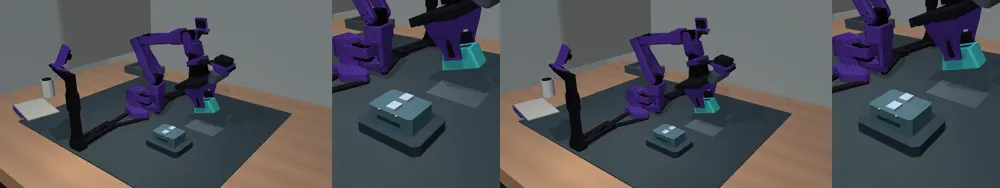

# Astra가 촉각을 다시 읽고 직접 놓기

두 레일 위에 물체를 수평으로 쌓는다. 색과 외형이 다른 사다리꼴, 역테이퍼, 비대칭 상단 셸을 준비했다. 세 형태는 PaXini가 닿는 너비와 전체 높이를 공유한다. 질량은 85 g이고 내부 추의 좌우 위치는 관측에서 가렸다. 각 조건에서 동일한 R7, 시작 자세, 그립, 운반 경로를 두 정책에 재현했다. 운반이 끝나고 놓기 직전부터 정책의 결정이 달라진다.

## 실행 결과

2026-11-23 13:07:05–13:29:46 KST에 실행했다. **36개 짝지은 조건, 총 72회**가 완결됐다. 중간 마무리 요청에 따라 진행 중이던 마지막 짝을 끝낸 뒤 종료했다. 실제 전체 경과는 **22분 41.7초**다.

| 정책 | 성공률 | 정지 재측정 횟수 | 평균 동작 (초) | 평균 모델 응답 (초) | 평균 합계 (초) | 중앙 합계 (초) |
| --- | ---: | ---: | ---: | ---: | ---: | ---: |
| 기존 규칙 | 34/36 (94.4%) | 7 | 7.97 | 0.00 | 7.97 | 7.84 |
| Astra xhigh | 33/36 (91.7%) | 1 | 7.63 | 32.03 | 39.66 | 40.55 |

같은 조건에서 **Astra만 성공 0회, 규칙만 성공 1회, 둘 다 성공 33회, 둘 다 실패 2회**였다. Astra가 유효한 배치 경로를 내지 못한 경우는 0회였다. 아래 결과는 이 형상과 치구에서 이뤄진 시뮬레이션 비교다.

| 물체 | 기존 규칙 성공 | Astra 성공 |
| --- | ---: | ---: |
| trapezoid | 10/10 | 9/10 |
| reverse-taper | 9/11 | 9/11 |
| slanted-cap | 15/15 | 15/15 |

**실제 모델 호출.** 38회 요청 중 38회가 모델 응답을 반환했다. 정지 재측정 직후에는 1회 요청했고 IK·형식 수정은 1회 요청했다. 별개 스레드 ID 38개와 별개 턴 ID 38개를 확인했다. 호출당 중앙값 **31.07초**, 최솟값 **16.01초**, 최댓값 **63.26초**를 기록했다. 토큰 기록이 있는 38회에서 총 **입력 845,289개**(캐시 입력 354,432개 포함), **출력 49,617개**(추론 40,708개 포함)를 기록했다.

[시행 전체와 원본 응답 이벤트](../data/stacking-pilot/free-placement/results.json) · [호출별 모델·시간·토큰 기록](../data/stacking-pilot/free-placement/call-index.json) · [요약 데이터](../data/stacking-pilot/free-placement/summary.json) · [실행 영상](../media/stacking/free-placement)

## 같은 조건에서 동작이 갈린 장면

왼쪽은 기존 규칙, 오른쪽은 Astra다. 영상은 로봇의 동작을 재생하며 모델 대기 시간은 호출 기록에 따로 남겼다.



- **b02-07 · 규칙만 성공.** 규칙은 운반 뒤 다시 읽고 TCP X를 215.53 mm로 옮겨 기울기 0.038°로 놓았다. Astra는 두 패드가 눌리고 추정 무게중심이 레일 폭 안에 있다고 판단해 곧바로 TCP X 218.00 mm에서 놓았고, 7.888°로 기울었다. 재측정과 배치 경로가 모두 바뀐 비교다. [규칙 영상](../media/stacking/free-placement/b02-07-rule.mp4) · [Astra 영상](../media/stacking/free-placement/b02-07-astra.mp4)
- **b01-23 · Astra가 다시 읽은 조건.** 모델이 운반 전후 Y 모멘트와 양쪽 압력 중심이 다르다고 보고 재측정을 요청했다. 새 이미지와 촉각으로 한 번 더 추론한 뒤 TCP X 209.8 mm, Y −101.3 mm에서 놓았다. 두 정책 모두 성공했다. [규칙 영상](../media/stacking/free-placement/b01-23-rule.mp4) · [Astra 영상](../media/stacking/free-placement/b01-23-astra.mp4)

기존 규칙이 이미 안정적으로 집고 운반하는 구간을 두 정책에 공유했고, 치구 위치를 둘 다 알고 있다. 이 실험은 기존 센서가 있는 상태에서 재측정과 배치 권한을 바꾼 비교다. PaXini 제거 효과, 실물 성능, 물체 탐색부터 시작하는 전체 과제의 성공률은 이 수치로 추정할 수 없다. [양쪽 77점 25 Hz 센서 원본](../data/stacking-pilot/free-placement/sensor-traces.json.gz)

## 두 정책이 받은 정보와 권한

| 정책 | 로봇이 다시 읽는 시점 | 놓는 좌표 |
| --- | --- | --- |
| 기존 규칙 | 이전 파일럿의 규칙. 운반 전후의 촉각 편심 추정이 임계값 이상 변하거나 운반 측정값이 부족하면 정지 재측정 | 측정한 X 방향 편심으로 레일 중심을 보정하고 고정 배치 궤적 실행 |
| GPT-6.2 Astra xhigh | 놓기 직전 한 번의 선택권. RGB와 MuJoCo 촉각 관측을 보고 바로 놓거나 정지 재측정 요청 | 모델이 웨이포인트별 XYZ, pitch, yaw, 턱 간격, 시간 직접 지정 |

Astra 입력은 좌우 RGB, 손목 RGB, 치구 근접 뷰, 양쪽 PaXini 접촉면 추정 지도, 최초 8샘플과 운반 말기 8샘플의 세계 좌표 힘·모멘트 및 각 패드의 합력과 압력 중심이다. 두 레일의 보정된 위치와 폭, 센서 좌표계, 턱 개폐 명령, 도달 가능한 자세 예시도 제공했다. 임계값, 내부 추 위치, 시뮬레이터의 물체 중심 좌표와 성공 여부는 정책 프롬프트에서 제외했다. 손목 깊이는 대시보드 표시용이다.

모델이 재측정을 요청하면 같은 자세에서 0.44초 정지한다. 새 카메라 영상과 정지 구간 촉각 8샘플을 다음 호출에 전달한다. 그 호출에서 배치 경로를 받는다. IK와 범위 검증에 실패하면 실제 오류와 같은 관측을 넣어 한 번 더 요청한다. 검증 통과한 웨이포인트는 변경 없이 실행하며, 두 번째에도 유효한 행동을 얻지 못하면 실패로 센다. 동일한 MuJoCo 진단으로 마지막 자세에서 2초 기다린 뒤 레일 접촉, 그립 해제, 기울기 5° 미만, 속도 0.03 m/s 미만을 확인했다.

## 실행 시간과 모델 기록

동작 시간은 첫 이동부터 배치 경로 마지막까지의 시뮬레이터 시간이다. 추론을 포함한 시간은 여기에 앱 서버 시작부터 요청 완료까지 실측한 벽시계 시간을 모두 더한 값이다. 재측정 뒤 호출과 IK 수정 요청도 포함했다. 2초 안정 판정은 공통 판정 구간으로 별도이고, 모델 응답을 기다리는 동안 물리 시계는 멈춰 있다. 별도 필드 `suite_wall_s`에는 렌더링을 동반한 실제 로컬 실행 경과 시간도 보존했다.

모델은 ChatGPT 로그인 상태의 Codex 앱 서버를 사용했다. 각 호출마다 새 임시 스레드와 턴을 개설하고 서버가 돌려준 모델과 추론 설정을 대조했다. 요청 시각, 완료 시각, 턴과 스레드 ID, 구조화된 원 응답, 서버의 입력·캐시·출력·추론 토큰 이벤트, 사용한 이미지 해시를 저장했다. 추론 토큰은 출력 토큰의 일부다. 캐시된 입력 접두사가 있는 호출도 각각 새 응답을 생성했다. 서비스 계정의 전체 사용량이나 차감은 이 로그에 포함되지 않는다. [OpenAI 추론 문서](https://developers.openai.com/api/docs/guides/reasoning)

## 재현

아래 명령은 저장된 모델 응답으로 비교를 다시 실행한다. 새 모델 호출 없이 배치 결과와 물리 동작 시간을 확인한다. 공개 장면은 기본값이고, 촬영에 쓴 개인 R7 Fusion 내보내기 장면은 `--scene /path/to/R7/scene.xml`로 전달할 수 있다.

```bash
python simulation/stacking/free_placement_summary.py data/stacking-pilot/free-placement/results.json
python simulation/stacking/free_placement_render.py data/stacking-pilot/free-placement/results.json --output placement-replay --physics-only
python simulation/stacking/free_placement.py --output placement-run --seconds 1800
python simulation/stacking/serve.py placement-run --port 8779
```
