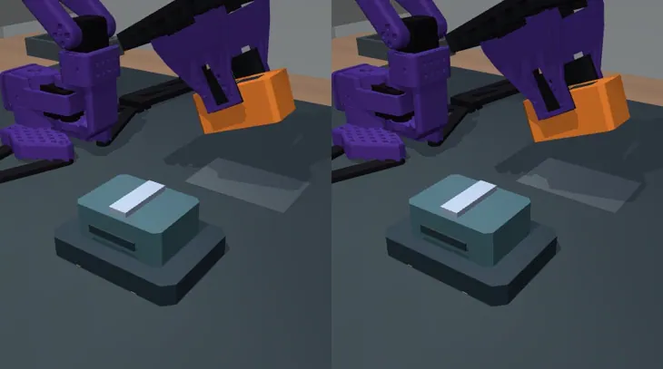
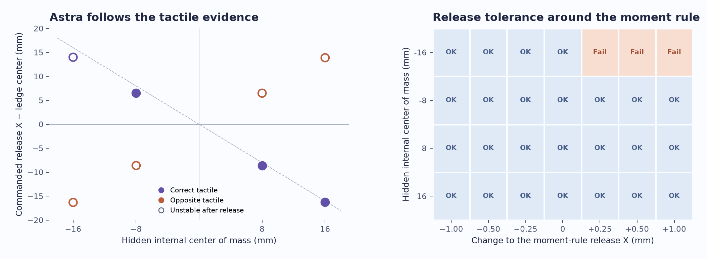

# PaXini가 모델의 배치 결정을 바꿨는가

같은 85 g 상부 부품과 R7 MuJoCo 장면에서, 앞선 ±13 mm에 쓰지 않았던 내부 무게중심 **−16, −8, +8, +16 mm**로 조건을 만들었다. 기존 Astra의 공통 들기 경로를 그대로 실행했다. 각 조건에서 같은 들기 RGB와 팔 상태를 유지하고, GPT-6.2 Astra `xhigh`에 **그 시행의 PaXini 요약** 또는 **같은 크기의 반대 편심 시행에서 측정한 PaXini 요약**을 제공했다. 두 입력 모두 같은 프롬프트 형식을 사용했다. 숨은 편심값과 최종 부품 자세는 채점기만 읽었다. [앞선 촉각 유무 파일럿](stacking-waypoint-pilot.ko.md)



왼쪽은 +16 mm 편심 부품의 실제 촉각으로 낸 경로이고, 오른쪽은 같은 물리 조건에 −16 mm 시행의 촉각을 준 경로다. [실제 촉각 영상](../media/stacking/feedback-ablation/right-16-astra_aligned.mp4) · [교체 촉각 영상](../media/stacking/feedback-ablation/right-16-astra_swapped.mp4)

| 배치 정책 | 안정 기준 통과 | 명령한 놓기 X, −16 / −8 / +8 / +16 mm 편심 순서 |
| --- | ---: | --- |
| Astra + 해당 시행의 PaXini | 3/4 | 218.0 / 210.5 / 195.4 / 187.74 mm |
| Astra + 반대편 시행의 PaXini | 0/4 | 187.7 / 195.4 / 210.5 / 217.9 mm |
| 모멘트 계산 규칙 | **4/4** | 217.89 / 210.50 / 195.42 / 187.74 mm |
| 받침 중앙 규칙 | 1/4 | 204 / 204 / 204 / 204 mm |

배치는 Astra 호출 8회와 규칙 실행 8회로 평가했다. 모델 호출별 경과 시간은 **13.6–17.8초**였다. 규칙 경로는 같은 높이·각도·동작 시간을 사용한다. 모멘트 규칙은 받침 중심 X에서 **Y 모멘트 ÷ 아래 방향 하중**을 뺐다. 손을 뗀 뒤 2초에 받침 접촉, 5° 미만 기울기, 선속도 0.03 m/s 미만과 해제를 모두 충족하면 성공으로 셌다.

Astra의 보정 방향은 **4개 물리 조건 모두**에서 PaXini 요약을 교체하자 뒤집혔다. 올바른 촉각에서 방향을 맞히고도 −16 mm에서 7.76° 기울었다. 이 표본에서는 센서 정보에 대한 의존성이 드러났고, 정지 상태의 물리를 직접 계산한 단순 규칙이 더 많이 통과했다. [모델 입력과 경로·결과](../data/stacking-pilot/feedback-ablation/results.json) · [25 Hz 센서와 실행 로그](../data/stacking-pilot/feedback-ablation/sensor-traces.json.gz)

## 마지막 자세에 오차가 생기는 구간

−16 mm 조건의 두 경로는 놓기 X가 0.106 mm밖에 차이 나지 않았다. 두 X 좌표를 두 경로에 각각 적용한 4회에서 **원래 규칙 경로와 원래 규칙 좌표의 조합만** 통과했다. 원래 규칙 X를 +0.25 mm 밀어도 실패했다. 이동과 내려놓기 과정이 포함된 결과이므로, 차이를 Astra의 무게중심 추정 하나에 귀속할 수 없다.



받침 위에서 **0.44초 정지하고 0.40초 조정**할 시간을 양쪽에 똑같이 준 추가 시험을 했다. 같은 시간 동안 기다리며 기존 좌표를 유지하면 **3/4**, 두 번째 PaXini 측정으로 좌표를 보정하면 **4/4**였다. 두 번째 조정은 계산 규칙으로 했다. 실패한 −16 mm 조건은 X **218.0 → 214.79 mm**, 기울기 **7.81° → 0.06°**로 바뀌었다. 이 조작은 실패를 본 뒤 같은 치구에서 설계한 탐색 결과다. [좌표 교차·민감도·재측정 로그](../data/stacking-pilot/feedback-ablation/release-sensitivity.json)

Astra에도 −16 mm의 같은 받침 위 RGB와 팔 상태를 준 뒤, 첫 들기 촉각과 받침 위에 도착한 뒤의 촉각을 각각 주고 다시 계획하게 했다. X는 **217.9 → 214.8 mm**로 바뀌었다. 두 경로 모두 안정 기준을 통과했다. 첫 들기 기록을 본 모델은 하강 중간점을 하나 더 넣었고, 최신 촉각을 본 모델은 일괄 하강했다. 이 한 쌍은 Astra가 최신 신호로 새 좌표를 고른 사례다. 두 경로의 성공률 차이는 관측되지 않았다. [Astra의 받침 위 재계획](../data/stacking-pilot/feedback-ablation/hover-model-results.json)

다음으로 보정용 치구와 새 시험 치구를 분리해, **언제 첫 측정이 운반 중 달라졌다고 판단하고 재측정할지** 비교한다. 첫 측정만 쓰는 정책, 항상 받침 위에서 다시 읽는 정책, 센서 변화가 큰 경우에만 다시 읽는 정책에 같은 실행기를 준다. 성공률과 추가 정지·조정 시간, 실제 X 오차를 함께 기록한다. 이 비교에서 촉각이 첫 무게중심 추정과 마지막 배치 보정에 각각 기여한 정도를 잴 수 있다.

## 재현

```bash
python simulation/stacking/feedback_ablation.py --replay-from data/stacking-pilot/feedback-ablation/results.json --output stack-feedback-replay
python simulation/stacking/release_sensitivity.py data/stacking-pilot/feedback-ablation/results.json --output stack-feedback-replay/release-sensitivity.json
```

앞선 쌓기 장면의 물체와 한 R7 시뮬레이션에서만 검증했다. 새 모델 호출에는 Codex 로그인 환경에서 `--source data/stacking-pilot/waypoint-pilot/results.json`을 쓴다. 모델이 본 프레임, 호출 응답, 보조 재계획 입력은 함께 저장했다. [실험 데이터](../data/stacking-pilot/feedback-ablation)
