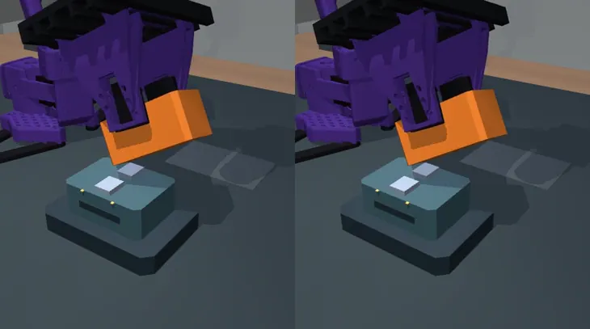

# 언제 촉각을 다시 읽어야 할까?

단일 받침을 두 개의 분리된 레일로 바꾸고 받침을 Y 방향으로 3 mm 옮겼다. 같은 85 g 부품에서 숨은 무게중심, 레일 폭, 운반 자세를 조합했다. 보정용 3조건과 평가용 8조건을 구분하고, 첫 들기 경로와 로컬 IK·제어기를 세 정책에 공유했다. [앞선 재측정 파일럿](stacking-feedback-ablation.ko.md)



A 조건에서 왼쪽은 첫 측정의 좌표를 계속 사용했다. 오른쪽은 Astra가 재측정을 선택하고 로컬 제어기가 좌표를 보정했다. [첫 측정 영상](../media/stacking/selective-recheck/rail-a-first.mp4) · [조건부 영상](../media/stacking/selective-recheck/rail-a-selective.mp4)

| 정책 | 평가 8조건 성공 | 정지 재측정 | 평균 로봇 동작 | 평균 동작 + CLI 응답 |
| --- | ---: | ---: | ---: | ---: |
| 처음에만 읽기 | 6/8 | 0/8 | 7.915 s | 7.915 s |
| 항상 다시 읽기 | 8/8 | 8/8 | 8.755 s | 8.755 s |
| Astra 조건부 | 8/8 | 2/8 | 8.125 s | 16.418 s |

조건부는 항상 읽기와 같은 8개를 통과했고, 정지 재측정 **6회(75%)**와 평균 동작 시간 **0.630초(7.2%)**를 줄였다. Astra 응답을 더하면 평균 **7.663초** 더 걸렸다. 로봇 동작 시간은 MuJoCo 시계의 이동·정지·조정·놓기 시간을 합친 값이다. 그 뒤의 2초 안정 판정은 세 조건에서 동일하게 별도로 시행했다. CLI 응답 시간은 프로세스 호출부터 결과 수신까지 실측해 각 시행에 더했다. 별개의 판단 호출은 최대 4개까지 병렬로 실행했다. [정책·시행·시간 원본](../data/stacking-pilot/selective-recheck/results.json)

## 조건부 정책이 무엇을 읽었나

첫 리프트에서 TCP 기준 Y 모멘트를 아래 방향 하중으로 나눠 물체의 편심을 추정한다. 운반이 끝날 때까지 이미 스트리밍된 마지막 4표본에서 유효한 추정을 얻고, 최초 추정과 얼마나 달라졌는지 계산한다. 정지해서 별도로 측정하는 동작에는 0.44초, 새 X에 맞추는 동작에는 0.40초를 할당했다.

재측정 임계값은 **2.0 mm와 레일 반폭의 36% 중 큰 값**이다. 충분한 운반 표본을 얻지 못하거나 변화량이 임계값 이상이면 다시 읽는다. 임계값을 고정하고 세 보정 조건에서 평가 경로와 집기 범위를 확인한 뒤, 8개 새 조건에서 같은 값을 사용했다. Astra는 임계값, 변화량, 초기 측정, 현재 TCP와 RGB를 보고 `remeasure`를 실제로 반환했다. 8개 응답 모두 로컬에서 계산한 같은 임계값과 일치했다. 하네스는 그 결정을 적용했다. 새 X의 계산과 움직임 실행은 공통 로컬 제어기가 맡았다.

재측정이 실제로 도움 된 두 조건의 운반 중 변화량은 **3.336 / 3.525 mm**였다. 처음의 좌표로 놓으면 **8.000° / 8.167°** 기울었고, 재측정 후는 **0.042° / 0.044°**였다. B 조건은 2.299 mm로 2.520 mm 기준보다 가까웠지만 두 고정 정책 모두 성공했다. 이 표본에서 유효했던 임계값의 일반화는 새 레일, 마찰과 물체에서 확인해야 한다.

## Astra 호출 확인

평가 중 `codex exec`에 모델 `gpt-6.2-astra`, `model_reasoning_effort="xhigh"`를 지정한 독립 호출 **8개**가 완료됐다. Codex CLI가 보고한 합계는 **입력 163,579토큰, 출력 387토큰, 추론 출력 토큰 0**이었다. 입력에는 CLI가 함께 넣는 지시와 이미지 토큰도 포함될 수 있다. 별도 런타임 구성 조회도 모델 `gpt-6.2-astra`, `xhigh`, 제공자 `openai`를 반환했다. 이 구성 확인에는 모델 응답을 요청하지 않았다. [호출별 응답·토큰·경과 시간](../data/stacking-pilot/selective-recheck/model-receipts.json) · [런타임 구성 확인](../data/stacking-pilot/selective-recheck/runtime-model-check.json)

이번 모델 비교는 제공한 재측정 기준에 따른 판단을 실행한 실험이다. 기준을 새로 발견하는 능력이나 실물 성능을 평가하는 실험은 후속이다. 로컬 임계값과 모델의 선택이 일치했으므로 매번 모델에 기준값을 비교하게 하는 호출은 여덟 조건에서 동작 선택을 개선하지 않았다.

## 재현

```bash
python simulation/stacking/recheck.py --replay-from data/stacking-pilot/selective-recheck/results.json --output recheck-replay
python simulation/stacking/recheck_render.py data/stacking-pilot/selective-recheck/results.json --output recheck-replay
cp data/stacking-pilot/selective-recheck/results.json recheck-replay/results.json
python simulation/stacking/serve.py recheck-replay --port 8778
```

`--replay-from`은 기존 결정으로 물리 실행만 검증한다. 새 모델 호출을 포함하려면 Codex CLI에 로그인한 상태에서 `--source data/stacking-pilot/feedback-ablation/results.json`을 쓴다. 기존 개인 R7 메시가 있으면 `--scene /path/to/R7/scene.xml`을 함께 지정할 수 있다. [대표 영상](../media/stacking/selective-recheck) · [25 Hz 양쪽 77점 센서 로그](../data/stacking-pilot/selective-recheck/sensor-traces.json.gz)
