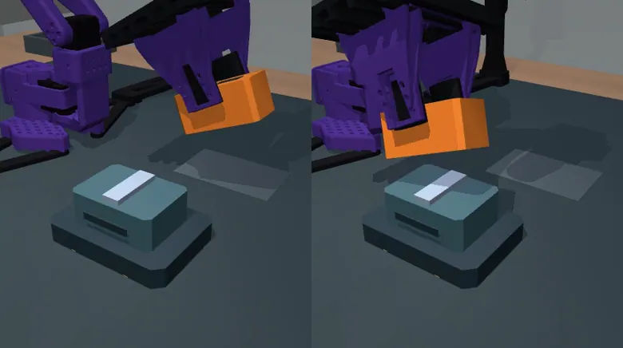

# 무게중심에 맞춰 웨이포인트를 바꾸는 R7

같은 85 g 상부 부품을 사용하고, 내부 무게중심만 부품 중심에서 좌우 13 mm 옮겼다. 받침의 두 하부 층은 미리 조립했다. SO-ARM101 R7 MuJoCo에서 GPT-6.2 Astra `xhigh`가 직접 낸 웨이포인트로 **상부 부품을 들어본 다음**, 카메라와 팔 상태에 PaXini 신호를 추가하면 올려놓는 위치와 결과가 달라지는지 확인했다.



두 영상 모두 오른쪽 편심 부품이다. 왼쪽은 카메라·관절 조건, 오른쪽은 PaXini를 추가한 조건이다. [왼쪽 영상](../media/stacking/pair-2-vision-arm.mp4) · [오른쪽 영상](../media/stacking/pair-2-touch.mp4)

| 내부 추 | 모델 입력 | Astra가 낸 release TCP X | 손을 뗀 뒤 기울기 | 안정 판정 |
| --- | --- | ---: | ---: | --- |
| 왼쪽 | 카메라·관절 | 204.0 mm | 0.433° | 통과 |
| 왼쪽 | 카메라·관절 + PaXini | **215.1 mm** | 0.342° | 통과 |
| 오른쪽 | 카메라·관절 | 204.0 mm | 7.977° | 실패 |
| 오른쪽 | 카메라·관절 + PaXini | **190.7 mm** | 0.156° | 통과 |

받침 중심은 X = 204 mm다. 네 시행 모두 그리퍼를 열고 물러났다. 하중을 뺀 뒤 2초에 받침과 접촉하고, 기울기 5° 미만, 선속도 0.03 m/s 미만, 양 패드 해제를 모두 충족하면 안정으로 판정했다. 오른쪽 추를 중앙에 놓은 부품은 받을 때 기대어 기울었다. 완전히 떨어진 사례로 세지 않았다.

### 무엇이 실제로 달라졌나

- **두 경우 모두 실제로 들어 올렸다.** Astra가 첫 장면에서 수치 웨이포인트 7개를 제출했다. 접근, 턱 닫기, 상승과 정지 구간을 포함한다. 양쪽 내부 추 조건에서 같은 경로를 실행했고 부품 중심은 작업대에서 약 69.5 mm 위까지 올라갔다. 최종 들기 구간에 양쪽 패드가 받은 수직 하중은 두 경우 모두 **0.8335 N**, TCP 기준 Y 모멘트는 각각 **−9.270 mNm / +11.121 mNm**였다.
- **센서 조건만 가렸다.** 각 내부 추 조건 안에서 두 후속 호출은 같은 들기 경로, 같은 들기 JPEG와 같은 그리퍼·관절 상태에서 시작했다. PaXini 조건에만 패드별 합력, 세계 좌표에서의 합력과 TCP 기준 모멘트, 표본 변동을 추가했다. 접촉면 추정과 77점 벡터는 대시보드와 기록에 포함했다. 모델은 요약 수치와 RGB를 읽었다.
- **모델이 위치·방향·간격·시간을 제안했다.** 액션 출력은 세 위치 중 하나를 택하는 이름표가 아닌 연속 수치의 XYZ, pitch, yaw, 턱 간격, 구간 시간 리스트다. 5축 R7의 로컬 하네스가 IK와 범위를 확인하고 관절 보간을 실행했다. 이 시험에서는 모델에 파지 작업대와 받침 위치, 상부 부품의 총질량을 알려주고 yaw 0°를 요청했다. 내부 편심은 채점기에만 있었다.
- **두 성공 경로를 서로 바꾸자 두 시행 모두 기준을 놓쳤다.** 왼쪽 내부 추에 오른쪽 추에서 낸 전체 경로를 적용하면 **8.109°**, 반대는 **8.224°** 기울었다. 이 추가 2회는 새 모델 호출 없이 반대 조건의 경로를 물리적으로 재실행했다.

PaXini 조건 **2/2**, 카메라·관절 조건 **1/2**다. 왼쪽 추의 카메라·관절 경로는 중앙을 명령했지만 실제 부품 중심이 받침에서 오른쪽으로 이동해 안정 기준을 통과했다. 명령한 TCP와 실제 부품 중심을 모두 남겼다. 4개 배치의 한 쌍 파일럿이며, 일반화와 실물 성능은 후속 검증 항목이다. [모델 결정과 결과](../data/stacking-pilot/waypoint-pilot/results.json) · [경로 교환 결과](../data/stacking-pilot/waypoint-pilot/swapped-placements.json) · [양쪽 77점 시계열](../data/stacking-pilot/waypoint-pilot/sensor-traces.json.gz)

### 다시 보기와 재현

[왼쪽 추 / 카메라·관절](../media/stacking/pair-1-vision-arm.mp4) · [왼쪽 추 / PaXini](../media/stacking/pair-1-touch.mp4) · [오른쪽 추 / 카메라·관절](../media/stacking/pair-2-vision-arm.mp4) · [오른쪽 추 / PaXini](../media/stacking/pair-2-touch.mp4). [좌우·손목 RGB·손목 깊이 영상](../media/stacking)

```bash
python -m pip install -r simulation/requirements.txt
python simulation/stacking/render.py data/stacking-pilot/waypoint-pilot/results.json --output stack-replay --physics-only
```

FFmpeg로 대시보드 재생 자료를 만들려면 `--physics-only`를 빼고 실행한다. `index.html`과 원본 `results.json`을 출력 디렉터리에도 복사한 뒤 `python simulation/stacking/serve.py stack-replay`로 볼 수 있다. 새 모델 호출과 진행 화면은 Codex CLI 로그인 환경에서 `python simulation/stacking/evaluate.py --output stack-run`으로 실행한다. 개인 R7 메시를 가진 경우 두 실행기에 `--scene /path/to/R7/scene.xml`을 준다. [원본 관찰과 모델 응답](../data/stacking-pilot/waypoint-pilot) · [쌓기 연구계획](tactile-stacking-protocol.ko.md)
