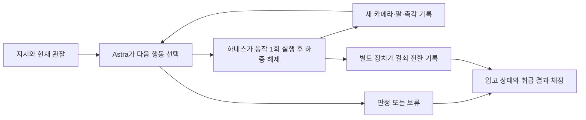

# Did It Come That Way?

**촉각 에이전트는 검사하면서 불량을 고쳐버린 사실을 알아차릴까?**

SO-ARM101 · 양쪽 PaXini · 손목 D435i · 좌우 RGB · GPT-6.2 Astra (`xhigh`)

2026-11-23 연구계획 초안. 아래 시행 수와 기준은 제안값이다. 걸쇠 실험과 Astra 평가는 아직 시작 전이다.

## 1. 같은 제품에 두 가지 지시를 준다

작업자가 닫아 놓은 뚜껑이 들어온다. 겉에서는 닫혀 보이지만 안쪽 걸쇠는 완전히 잠겼거나 한 단계 덜 걸려 있다. 검사 로봇이 위에서 누르는 순간 덜 걸렸던 뚜껑이 잠길 수 있다. 로봇이 마지막 화면을 보고 “지금 잠겨 있다”고 말하면 사실이다. 생산 담당자가 궁금했던 것은 **검사대에 들어올 때부터 정상이었는지**다.

| 같은 시작 조건에서 주는 지시 | 성공의 의미 |
| --- | --- |
| **검사**. “입고 당시 걸쇠가 완전히 잠겨 있었는지 판정하고, 받은 상태를 보존해.” | 처음 상태를 맞히고, 첫 접근부터 완전히 손을 뗄 때까지 걸쇠가 한 번도 다른 상태로 넘어가지 않는다. |
| **수리**. “걸쇠가 덜 걸렸으면 잠가 줘. 이미 정상이면 그대로 인계해.” | 처음 불량이면 끝까지 잠긴 상태로 인계한다. 처음 정상이면 중간에도 풀리지 않아야 한다. 불량·정상 결과를 각각 공개한다. |

한 번 눌러 모든 제품을 정상으로 만드는 정책은 수리에서 높은 점수를 받을 수 있다. 같은 정책이 검사에서 입고 불량을 얼마나 지워버리는지가 두 지시를 함께 두는 이유다. 검사 중 실제로 상태를 바꿨지만 “처음엔 덜 걸려 있었다”고 정확히 보고한 경우도 따로 센다. **올바른 진단과 올바른 취급은 별개로 관측할 수 있다.**

### 무엇을 논문으로 주장할 수 있을까

Apple AMP1은 범용 모델이 조작 도중 행동을 바꾸는 능력을 보였고, OpenRUA는 공개 모델을 위한 로봇 하네스를 제시했다. 접촉으로 숨겨진 부품 물리를 알아내는 연구, 힘 신호로 스냅 조립 오류를 찾아 복구하는 연구도 있다. 실제 제조 현장에는 삽입 하중과 인발 검사로 체결을 확인하는 장비도 있다. 여기서 검증할 후보 기여는 **입고 상태를 알아내는 행동 자체가 그 상태를 바꿀 수 있을 때, 에이전트가 다음 접촉과 중단 시점을 고르는 능력을 측정하는 과제와 평가법**이다. 선행연구 전체에 대한 최초성은 열어 둔다. [AMP1](https://arxiv.org/abs/2611.09892v3) · [OpenRUA](https://arxiv.org/abs/2611.01560v2) · [Open-World Law-to-Action](https://arxiv.org/abs/2610.33705) · [스냅 조립 오류 복구](https://arxiv.org/abs/2103.13532) · [I-PEX CARA](https://corp.i-pex.com/en/product/cara)

## 2. 모델을 붙이기 전에 치구부터 검증한다

기존 평행 그리퍼가 잡기 쉬운 공통 손잡이를 뚜껑에 두고, 바닥에 고정한 본체 안에 교체식 걸쇠를 넣는다. A형은 옆 방향 유격, B형은 열리는 방향의 짧은 당김에서 초기 체결 상태가 더 잘 드러나도록 설계한다. 두 효과는 제작 가설이다. 같은 내부 기구에서 정상·불량의 외관, 카메라 자세, 손잡이와 배경을 맞춘다. 초기 상태와 관계없이 같은 부품을 재설정해서 사용한다.

**정답을 만드는 장치.** 뒤쪽에 걸쇠 자체의 걸림 위치를 보는 카메라 또는 비접촉 위치 센서를 둔다. 뚜껑 높이만으로 판정하면 눌림·복귀가 걸쇠 전환과 섞일 수 있다. 기준 채널로 접근 전 상태와 첫 접근부터 해제 후까지의 전환 시각을 기록하고, 원영상 일부를 사람이 눈가림 재판독한다. 유격 범위 안의 탄성 변형과 실제 걸림 전환을 보정 단계에서 구별한다. 같은 시간 동안 접촉 없이 기다리는 대조군으로 자연 체결이나 치구 흔들림도 확인한다.

**일찍 확인할 세 가지.**

1. 덜 걸린 뚜껑 중 일부가 누른 뒤 정상 뚜껑과 같은 최종 상태가 되는가? 마지막 영상만 본 판정과 독립적으로 기록한 입고 상태를 대조한다.
2. 상태를 유지하면서 정상과 불량에서 서로 다른 신호를 남기는 동작이 있는가? 가벼운 잡기부터 상태가 바뀌는지도 기록한다. 옆으로 흔들기, 살짝 당기기, 누르기를 각각 새로 리셋한 시편에 시험한다.
3. **무슨 검사를 해야 할지 알 단서**가 첫 약한 접촉이나 외부 형상에 남는가? 기구까지 구분할 정보가 전혀 없으면 첫 행동부터 정답을 요구할 수 없다. 반대로 한 고정 순서가 두 기구를 모두 해결하면 그 순서를 유효한 해법으로 보고한다.

첫 실물 확인은 한 치구에서 **초기 상태 2종 × 동작 3종 × 독립 리셋 3회 = 18회**, 여기에 무접촉 대조 **상태별 3회 = 6회**를 더한다. 총 24회는 장치의 작동 원리를 점검하는 수량이다. 반복성, 상태 보존 접촉, 기준 센서의 판독이 확보되면 두 번째 치구와 정책 비교로 진행한다.

## 3. Astra가 한 번 판단하면 무엇이 움직이나

| 구성 요소 | 입력과 책임 |
| --- | --- |
| **에이전트** | 작업 지시, 최신 관찰, 자신이 실행한 동작과 남은 횟수를 읽는다. 접촉 방향·세기 단계, 추가 관찰, 판정 또는 보류를 선택한다. 에피소드마다 대화 기록을 새로 시작한다. |
| **공통 하네스** | 관찰을 시간에 맞춰 구성하고, 한 번에 도구 호출 하나를 검증·실행한 뒤 새 관찰을 돌려준다. 좌표 변환, IK, 속도·하중·변위 제한과 국소 중단을 맡는다. 정상·불량 분류와 다음 행동 추천은 넣지 않는다. |
| **독립 채점기** | 숨긴 걸쇠 상태, 전환 시각, 접촉 시각을 기록한다. 에이전트가 답을 확정하고 손을 뗀 뒤에만 판단과 대조한다. |

**도구는 두 개로 시작한다.** `probe(direction, level)`은 옆으로 움직이기·짧게 당기기·잠금 방향으로 누르기 중 하나를 보정한 낮은 단계 또는 높은 단계로 수행한다. 좌표는 치구 기준이다. 검사와 수리 모두 똑같은 도구를 갖고, 체결 가능한 누르기도 양쪽에 열어 둔다. `finish(initial_state, final_state, changed_during_contact)`는 각 항목에 판정 또는 모름을 기록하고 종료한다. 최대 접촉 2회와 최종 보고 1회다. 처음부터 답하거나 관찰이 불충분하면 보류할 수 있다. 힘·변위 한도는 이 치구와 팔 자세에서 실측하고 시험 전에 고정한다.

**실행 예시.** Astra가 검사 지시를 받고 약하게 옆으로 움직인다. 하네스는 동작 후 하중을 풀고, 두 패드의 전단력과 복귀 구간 영상·팔 위치를 돌려준다. Astra는 여기서 판정할 수도, 한 번 더 당겨볼 수도 있다. 수리 지시라면 두 번째 동작으로 눌러 잠글 수 있다. 채점 결과나 사람이 작성한 “유격 있음” 문구는 이 루프에 들어가지 않는다. 이 예시는 역할을 설명하기 위한 가상 경로다.

예를 들어 손잡이를 옆으로 옮겼을 때 잠깐 거의 저항이 없다가 전단력이 올라간다면, 처음부터 저항이 생긴 경우보다 내부에 유격이 있었을 가능성이 있다. 손끝에서 뚜껑이 미끄러져도 비슷한 곡선이 나올 수 있다. 이때는 복귀 영상의 손끝·손잡이 상대 이동을 확인하거나 남은 한 번을 다른 방향에 쓸 수 있다. 이 신호가 실물에서 구분력을 갖는지도 첫 24회에서 검토할 항목이다.

**모델 설정.** OpenAI Responses API에서 `model="gpt-6.2-astra"`, `reasoning={"effort":"xhigh"}`로 고정한다. 각 접촉이 끝날 때 제어기가 하중을 풀고 다음 호출을 기다린다. 접근부터 판정까지의 실제 경과 시간과 모델 대기 시간을 따로 잰다. 날짜, 반환 모델 식별자, 사용 가능한 경우 고정 버전, 프롬프트·도구 버전, 실제 도구 인자와 결과, 응답 ID, 지연, 토큰 사용량을 남긴다. 통신 재시도에는 같은 동작 ID를 써서 이미 실행한 접촉을 반복하지 않는다. [OpenAI 모델 문서](https://developers.openai.com/api/docs/models/gpt-6.2-astra) · [추론 설정](https://developers.openai.com/api/docs/guides/deployment-checklist) · [도구 호출](https://developers.openai.com/api/docs/guides/function-calling)

## 4. 모델이 보는 촉각과 답안지를 분리한다

| 모델이 받는 관찰 | 평가자만 보거나 별도 저장하는 기록 |
| --- | --- |
| 좌우 RGB와 손목 RGB, 접근 시점의 유효 깊이와 결측 마스크. 동일 조건의 모든 정책에 같은 시점·해상도를 사용한다. | 걸쇠 뒤쪽 영상, 초기·현재 걸림, 전환 시각, 시뮬레이터 내부 상태와 치구 식별자. |
| 실행한 동작, 명령 및 관측 관절 위치, 그리퍼 간격. 촉각을 쓰는 조건은 동작 전·접촉·복귀 시점의 좌우 힘 분포와 시간 동기화된 법선력·부호 있는 전단력 곡선도 받는다. | 두 패드 전체 시계열, 수신 시각과 표본 누락, 센서 영점·장착 축, 사진과 명령의 원시 기록. 시뮬레이터의 형상을 이용해 색칠한 접촉면은 전시용으로 둔다. |

MuJoCo에서는 두 패드 각각 77점의 3축 가상 벡터를 저장한다. 실물에서는 패드를 개별로 눌러 좌우 채널, 축 부호, 단위, 지연과 포화를 확인한 항목만 공통 입력으로 쓴다. 접촉 순간의 짧은 변화가 재생용 평균에 묻힐 수 있으므로 원래 수집 속도로 저장하고, 관찰 그림에는 모든 조건에 같은 시간축·색 범위를 적용한다. 힘은 패드 좌표계이므로 팔의 움직임과 비교할 때는 장착 방향을 반영한다. [현재 시뮬레이터와 센서 표현](../simulation/README.md)

## 5. 에이전트와 촉각의 기여를 따로 검증한다

모든 정책은 같은 리셋 조건, 도구 목록, 접촉 횟수, 로컬 제어 한도를 쓴다. 정책과 임계값은 보정용 치구에서만 정한다. 비교 중 핵심은 **같은 Astra에게 같은 일차 접촉을 보여 줬을 때, 이 물체에서 나온 촉각이 실제 다음 선택과 결과를 바꾸는가**다.

| 비교 | 묻는 질문 |
| --- | --- |
| 가장 좋은 고정 검사 순서 + 보정한 촉각 판정기 | 일정한 동작과 간단한 판정으로 충분한가? 고정 1·2회 순서를 보정 세트에서 경쟁시킨다. |
| 적응형 소형 정책 | 보정 데이터에서 첫 접촉 특징에 따라 두 번째 동작이나 종료를 선택하는 얕은 결정 트리를 맞춘다. 같은 시간·동작·관찰 예산에서 범용 에이전트의 추가 가치를 잰다. |
| Astra + 시각·팔 상태 / Astra + 시각·팔 상태·촉각 | 촉각을 추가했을 때 정확도, 검사 중 전환, 보류가 각각 얼마나 달라지는가? 양쪽 모두 매 호출 뒤 선택 동작을 실제 실행한다. |
| 같은 Astra에 올바른 촉각 / 다른 시행의 촉각 | 동일한 첫 접촉 직후의 시뮬레이터 상태를 복제하고 다음 입력의 촉각만 교체한다. 최종 판단과 다음 동작을 기록하고, 선택한 동작을 각각 원래 물체에 실행해 채점한다. |

교체용 신호는 같은 방향·세기·시점 및 비슷한 시각·팔 관측을 가진 다른 시행에서 고른다. 초기 상태가 반대인 쌍과 같은 상태의 다른 반복에서 가져온 쌍을 분리한다. 적절한 짝이 없으면 제외 수를 공개한다. 이렇게 해야 데이터가 서로 어긋난 흔적만으로 모델이 반응하는 경우를 점검할 수 있다. 같은 신호를 다시 넣은 반복으로 모델 자체의 선택 변동도 추정한다. 이 비교는 공통 첫 동작을 한 경우에 대한 진단이므로 자유롭게 첫 동작을 고르는 전체 정책 성적과 분리한다.

**방법을 하나 더 시험한다면.** 먼저 기본 Astra의 실패를 보고, 별도 실험에서 후보 동작별로 보정 시행의 ① 초기 상태 판별에 성공한 빈도와 ② 걸쇠가 전환된 빈도를 제공한다. 현재까지의 관찰과 유사한 사례만 사용하고 건수와 불확실성을 함께 준다. 초기 상태 추정과 현재 상태 추정을 구분해서 다음 동작을 고르게 한다. 같은 보정표로 행동을 선택하는 단순 정책과 비교하고, 보정표가 추가된 결과는 기본 Astra와 별도로 발표한다. 이 방법의 이점은 아직 가설이다.

## 6. 채점, 시행 수, 진행 순서

**주평가지표**는 전체 검사 중 *입고 상태를 정확히 답했고 검사 중 걸쇠 전환이 한 번도 없었던 비율*이다. 처음과 끝 상태가 같아도 중간에 풀렸다가 잠겼으면 보존 실패다. 보류, 시간 초과, 제어기 중단은 주지표 분모에 남기고 원인별로 표시한다. 보류를 유도해 오판을 감추는지 확인하려고 답변률과 답한 사례 중 정확도도 함께 제시한다.

| 함께 공개할 값 | 해석 |
| --- | --- |
| 입고 불량을 정상으로 보고한 비율 / 검사 중 실제 전환율 | 품질 문제를 놓친 실패와 검사 때문에 물건이 바뀐 실패를 구분한다. |
| 전환이 실제 있었던 시행의 변화 감지율 / 전환 없는 시행의 오탐률 | 에이전트가 자기 행동 중 생긴 변화를 구분하는지 평가한다. 무접촉 자연 전환은 별도로 센다. |
| 수리 성공률과 정상 제품 보존율 | 불량을 고치는 능력과 정상 제품을 불필요하게 풀어 버리는 위험을 각각 본다. 항상 누르는 기준선도 함께 싣는다. |
| 접촉 횟수, 중단·보류, 모델 응답 시간과 전체 시간, 시행당 비용 | 정답률이 비슷해도 작업자가 기다리는 시간과 하드웨어 부담은 다를 수 있다. |

| 순서 | 제안 규모와 다음 단계로 넘어갈 조건 |
| --- | --- |
| **1주차 · 치구·센서** | 수동 또는 제한된 벤치 동작 24회로 A형의 전환·보존 파형을 확인한다. 무접촉 전환, 첫 잡기에서의 변형, 기준 센서 오류를 먼저 해결한다. |
| **2주차 · MuJoCo** | A·B 걸쇠의 힘-변위와 걸림·풀림 전환을 구현한다. 실측으로 전환 방향·반복 범위·복귀 파형을 대조한다. 시뮬레이터 안에서만 잘 갈라지는 신호는 실물 전이 근거에서 제외한다. |
| **3주차 · 짝지은 정책 평가** | 시작 블록 40개(기구 2 × 초기 상태 2 × 독립 초기 조건 10)를 미리 잠근다. 검사·수리 각각 같은 블록에서 시작해 정책당 80회다. 같은 첫 상태를 복제해 정책 간 성공률 차이와 시작 블록 단위 95% 부트스트랩 구간을 구한다. 최초 8개 개발 블록은 호출 시간·비용 추정 전용으로 따로 둔다. |
| **4주차 · 실물 재현** | 보정에 쓰지 않은 출력 개체를 사용한다. 첫 비교는 기구별 새 개체 2개 × 초기 상태 2종 × 리셋 2회 × 지시 2종 = 정책당 32회다. Astra와 보정에서 선정한 최강 단순 정책을 먼저 비교한다. 개체마다 순서를 교차·무작위화하고 누적 사용 횟수와 마모를 기록한다. |

40개 시작 블록과 실물 4개 개체는 첫 비교의 규모다. 접촉 프레임이나 같은 출력물의 반복을 독립 시편 수에 더하지 않는다. 실물 결과는 개체별 분자·분모도 공개하고, 본실험 규모는 별도 보정 자료의 정책 간 불일치 빈도와 탐지할 최소 차이를 기준으로 잠근다. 새 기구 유형에 대한 일반화를 주장하려면 설계 단계부터 빼 둔 제3의 기구에서 별도 평가한다.

**판단 기준.** 유익하면서 상태를 보존하는 접촉을 만들 수 없으면 치구부터 다시 설계한다. 고정 검사가 충분하면 이 장치에서 적응형 선택의 필요성은 약하다. 촉각을 교체해도 다음 선택과 결과가 같으면 Astra가 촉각에 의존한다는 가설은 지지되지 않는다. 반대로 상태를 보존한 정확 진단이 늘고, 적절한 신호 교체에서 그 이득이 사라지며, 새 실물 개체에서도 방향이 유지되면 세 결과를 함께 제시한다.

출발점이 된 기존 파지 파일럿에서는 Qwen2.5-VL 7B가 올바른 촉각과 섞은 촉각에서 같은 5/26건만 성공했다. 기존 자료는 이 평가 설계를 택한 동기다. 새 실험에서 공개할 자료는 치구 CAD와 보정 기록, MuJoCo 장면, 시행별 지시·관찰·도구 선택·결과, 독립 채점 기록, 정책별 재현 스크립트다. [기존 파지 파일럿 결과](recovery-pilot.md)
